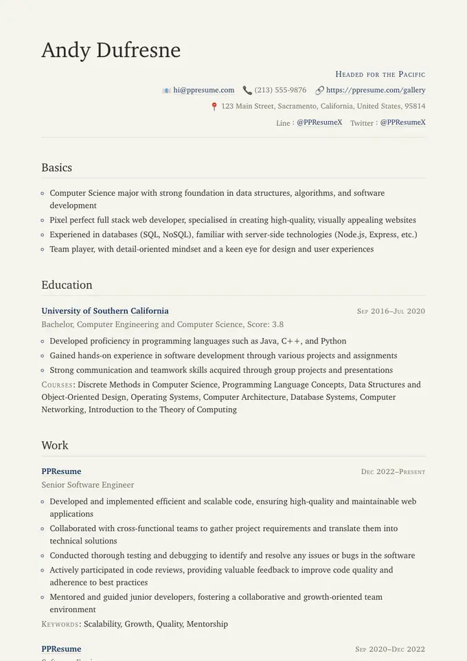

# YAMLResume

[English](./README.md) | [Français](./readmes/README-fr.md) |
[Deutsch](./readmes/README-de.md) | [Español](./readmes/README-es.md) |
[Português](./readmes/README-pt.md) | [Bahasa Indonesia](./readmes/README-id.md)
| [日本語](./readmes/README-ja.md) | [简体中文](./readmes/README-zh-cn.md) |
[繁體中文](./readmes/README-zh-tw.md)

**Resumes as code.** Write your resume in plain-text YAML, version it with Git,
and compile it into pixel-perfect PDFs, HTML, Markdown, and DOCX — in one
command.

[](https://github.com/yamlresume/yamlresume/actions/workflows/test.yml)
[](https://www.npmjs.com/package/yamlresume)
[](https://www.npmjs.com/package/yamlresume)
[](https://github.com/yamlresume/yamlresume)
[](https://yamlresume.dev)
[](./LICENSE)

> **News:**
> [YAMLResume v0.18](https://github.com/yamlresume/yamlresume/releases) ships
> the Typst engine, alongside curated sample resumes in 13 locales and
> AI-powered generation and translation. Also check out the
> [YAMLResume GitHub Action](https://github.com/marketplace/actions/yamlresume)
> to automate PDF builds in CI/CD.


## **Website & Autofill Extension**

[](https://app.zapply.jobs/onboarding/?ref=github-cta-yamlresume)

Explore Zapply’s website and check out:

- Our Chrome extension, which autofills job applications in seconds.
- A dedicated job board featuring the latest openings across various roles.
- User accounts with multiple profiles for different resume types and roles.
- Job application tracking with streaks and commitment awards.

Experience an advanced career journey with us! 🚀

<p align="center">
<a href="https://app.zapply.jobs/onboarding/?ref=github-cta-yamlresume">

</a>
</p>

<p align="right"><sub>Sponsored by Zapply</sub></p>

----

## Why YAMLResume

- **Formatting is not your job.** Your content stays separate from presentation;
  the compiler owns fonts, spacing, margins, and page breaks.
- **Your resume becomes reviewable.** Diff, blame, branch, and revert a resume
  the same way you do code. Every version is a commit.
- **One file, every format.** Recruiters want PDF, some portals want DOCX, your
  site wants HTML. Change one section and all of them update together.
- **Mistakes fail loudly, early.** A strict schema catches a bad date or a
  misspelled section before you send it, not after the interview.

## Quick Start

Try it with zero setup in the [Playground](https://yamlresume.dev/playground)
— no install, no LaTeX, live preview.

From the command line, `npx` gets you a working resume in two commands:

```sh
npx yamlresume new resume.yml   # scaffold a complete, valid resume
npx yamlresume build resume.yml # compile every configured layout
```

LaTeX PDF output needs a TeX engine on your machine. Without one, add
`--no-pdf` to get HTML, Markdown, and DOCX anyway, or use the Docker image
below, which bundles everything.

<details>
<summary>Install permanently (npm, pnpm, yarn, bun, Homebrew, Docker)</summary>

Node.js >= 22 is required for the package-manager installs:

```sh
# npm
npm install -g yamlresume

# pnpm
pnpm add -g yamlresume

# yarn
yarn global add yamlresume

# bun
bun add -g yamlresume

# Homebrew (macOS)
brew install yamlresume
```

The Docker image bundles the CLI, XeTeX, Typst, and the recommended fonts, so
nothing else needs installing:

```sh
docker run --rm -v $(pwd):/home/yamlresume yamlresume/yamlresume new my-resume.yml
docker run --rm -v $(pwd):/home/yamlresume yamlresume/yamlresume build my-resume.yml
```

[](https://asciinema.org/a/722057)

</details>

PDF output needs a typesetting engine (XeTeX or Typst). Check what your machine
is missing:

```sh
yamlresume doctor
```

For the full setup, including engine and font installation, see the
[installation guide](https://yamlresume.dev/docs/installation).

## Your resume is just YAML

No proprietary format, no database, no account:

```yml
# yaml-language-server: $schema=https://yamlresume.dev/schema.json
content:
  basics:
    name: Andy Dufresne
    headline: Backend Engineer
    email: andy@example.com
    summary: Backend engineer with 6 years building distributed systems.
  work:
    - name: PPResume
      position: Senior Engineer
      startDate: Jan 2022
      summary: Rewrote the typesetting engine; cut p99 latency by 40%.
  education:
    - institution: University of Southern California
      area: Computer Science
      degree: Bachelor
```

That `yaml-language-server` line is the whole editor story: it turns on
autocomplete, hover docs, and inline validation in VS Code, Neovim, JetBrains,
or anything else backed by the
[YAML language
server](https://github.com/redhat-developer/yaml-language-server).

Build it:

```sh
$ yamlresume build resume.yml
✔ Generated resume html file successfully: resume.html
✔ Generated resume tex file successfully: resume.tex
◐ Generating resume pdf file with command: xelatex -halt-on-error resume.tex...
✔ Generated resume pdf file successfully: resume.tex.pdf
✔ Generated resume docx file successfully: resume.docx
✔ Generated resume markdown file successfully: resume.md
✔ Generated resume typ file successfully: resume.typ
◐ Generating resume pdf file with command: typst compile resume.typ resume.typ.pdf...
✔ Generated resume pdf file successfully: resume.typ.pdf
```

Two PDFs because the default layouts enable both PDF engines; disable one in
`layouts:` and the other keeps the plain `resume.pdf` name.

Or get a rebuild on every save, like a web dev server:

```sh
yamlresume dev resume.yml
```

Check out the result: [PDF](./docs/static/images/resume.pdf) ·
[page 1](./docs/static/images/resume-1.webp) ·
[page 2](./docs/static/images/resume-2.webp)


Want to start from something real? `yamlresume new --sample <id>` scaffolds one
of 20 curated resumes, and `yamlresume samples list` shows what is available.

## Features at a Glance

- **One source, five engines.** LaTeX, Typst, HTML, Markdown, and DOCX from a
  single `resume.yml`.
- **A real resume compiler.** Parse, validate, transform, render — with Zod
  runtime validation and JSON Schema editor integration.
- **Great developer experience.** `yamlresume dev` for watch mode,
  `yamlresume doctor` for environment diagnostics, `yamlresume validate` for
  clang-style errors.
- **AI-powered generation and translation.** Bootstrap a resume from a job
  title, or translate an existing one, without hand-editing YAML.
- **Global by default.** 11 languages across 13 locale codes, plus per-template
  typography, paper size, and section ordering.

## Templates

Nine templates across five engines. Every preview below is the same resume and
the same YAML, rendered by a different engine — click one to open it in the
[gallery](https://yamlresume.dev/gallery/templates).

<table>
<tr>
<td align="center" width="33%">
<a href="https://yamlresume.dev/gallery/templates/latex/jake"></a>
<br><b>Jake</b> · LaTeX
<br><sub>Simple, straight-forward single column</sub>
</td>
<td align="center" width="33%">
<a href="https://yamlresume.dev/gallery/templates/latex/moderncv-banking"></a>
<br><b>ModernCV Banking</b> · LaTeX
<br><sub>ModernCV's conservative banking style</sub>
</td>
<td align="center" width="33%">
<a href="https://yamlresume.dev/gallery/templates/latex/moderncv-casual"></a>
<br><b>ModernCV Casual</b> · LaTeX
<br><sub>ModernCV's casual, less formal style</sub>
</td>
</tr>
<tr>
<td align="center" width="33%">
<a href="https://yamlresume.dev/gallery/templates/latex/moderncv-classic"></a>
<br><b>ModernCV Classic</b> · LaTeX
<br><sub>ModernCV's classic layout</sub>
</td>
<td align="center" width="33%">
<a href="https://yamlresume.dev/gallery/templates/typst/jake"></a>
<br><b>Jake</b> · Typst
<br><sub>Jake's layout, rendered with Typst</sub>
</td>
<td align="center" width="33%">
<a href="https://yamlresume.dev/gallery/templates/html/calm"></a>
<br><b>Calm</b> · HTML
<br><sub>Clean and minimalist, all professionals</sub>
</td>
</tr>
<tr>
<td align="center" width="33%">
<a href="https://yamlresume.dev/gallery/templates/html/kami"></a>
<br><b>Kami</b> · HTML
<br><sub>Warm parchment, single serif voice</sub>
</td>
<td align="center" width="33%">
<a href="https://yamlresume.dev/gallery/templates/html/vscode"></a>
<br><b>VS Code</b> · HTML
<br><sub>Dark theme for developer resumes</sub>
</td>
<td align="center" width="33%">
<a href="https://yamlresume.dev/gallery/templates/docx/calm"></a>
<br><b>Calm</b> · DOCX
<br><sub>Editable Word file, same clean layout</sub>
</td>
</tr>
</table>

Run `yamlresume templates list` to see what your install ships with, and
`yamlresume build` to render every layout you configured.

Templates are just the starting point — typography, margins, paper size, icons,
and section order are all configurable per layout.

## One resume, many layouts

Layouts decouple your content from presentation. Declare as many output formats
as you need:

```yml
layouts:
  - engine: latex
    template: moderncv-banking
    typography:
      fontSize: 11pt
  - engine: typst
    template: jake
  - engine: markdown
  - engine: html
    template: calm
  - engine: docx
    template: calm
```

Learn more about each engine:
[LaTeX / PDF](https://yamlresume.dev/docs/layouts/latex) ·
[Typst / PDF](https://yamlresume.dev/docs/layouts/typst) ·
[HTML](https://yamlresume.dev/docs/layouts/html) ·
[Markdown](https://yamlresume.dev/docs/layouts/markdown) ·
[DOCX](https://yamlresume.dev/docs/layouts/docx)

## Validating resumes

Run `yamlresume validate resume.yml` for compiler-style diagnostics, in your
terminal and in CI:


The schema itself is published at
[yamlresume.dev/schema.json](https://yamlresume.dev/schema.json). See the
[schema docs](https://yamlresume.dev/docs/compiler/schema) for details.

## AI-powered generation

Generate a complete, schema-valid starting point from a position and language:

```sh
export OPENAI_API_KEY=sk-...
yamlresume ai generate --position "Software Engineer" --language en resume.yml
```

Or translate an existing resume into another locale without touching the YAML:

```sh
yamlresume ai translate resume.yml resume-ja.yml --to ja
```

Supported providers include OpenAI, DeepSeek, Kimi, and Ollama. Read the
[AI documentation](https://yamlresume.dev/docs/ai) for setup details.

## Languages

Localization is built in. Set your locale in `resume.yml`, or run
`yamlresume languages list`:

```yml
locale:
  language: en
```

Supported: English, Simplified Chinese, Traditional Chinese (Hong Kong and
Taiwan), Spanish, French, Italian, Norwegian, Dutch, Japanese, German,
Indonesian, and Brazilian Portuguese — 11 languages across 13 locale codes.
See the [locale docs](https://yamlresume.dev/docs/locale) for the full list.

## Ecosystem

| Package | What it does |
| ------- | ------------ |
| [`yamlresume`](https://www.npmjs.com/package/yamlresume) | The CLI: build, dev, validate, generate, translate. |
| [`@yamlresume/ai`](https://www.npmjs.com/package/@yamlresume/ai) | Programmatic AI-powered resume generation. |
| [`@yamlresume/playground`](https://www.npmjs.com/package/@yamlresume/playground) | Embeddable React editor and preview component. |
| [`@yamlresume/samples`](https://www.npmjs.com/package/@yamlresume/samples) | Curated sample resumes in 13 locales. |
| [`create-yamlresume`](https://yamlresume.dev/docs/ecosystem/create-yamlresume) | Scaffold a new project in one command. |
| [`json2yamlresume`](https://yamlresume.dev/docs/ecosystem/json2yamlresume) | Convert [JSON Resume](https://jsonresume.org/) files to YAML. |
| [`yamlresume/action`](https://github.com/marketplace/actions/yamlresume) | Build resumes in GitHub Actions. |
| [Docker](https://hub.docker.com/r/yamlresume/yamlresume) / [Homebrew](https://formulae.brew.sh/formula/yamlresume) | Install without a local toolchain. |

## FAQ

<details>
<summary>Do I need LaTeX installed?</summary>

Only for LaTeX PDF output. HTML, Markdown, and DOCX need nothing beyond
Node.js, and the [Playground](https://yamlresume.dev/playground) renders them
in the browser. For PDF without a local toolchain, use the Docker image, which
bundles XeTeX, Typst, and fonts.
</details>

<details>
<summary>Why does `build` fail with `xelatex: command not found`?</summary>

No TeX distribution on your `PATH`. Run `yamlresume doctor` for a per-dependency
report, then follow the
[installation guide](https://yamlresume.dev/docs/installation), or drop the
LaTeX layout and build with Typst instead.
</details>

<details>
<summary>Can I use my existing JSON Resume?</summary>

Yes — `npx json2yamlresume` converts a
[JSON Resume](https://jsonresume.org/) file into YAMLResume format.
</details>

<details>
<summary>How do I rebuild my resume automatically?</summary>

Add the [GitHub Action](https://github.com/marketplace/actions/yamlresume) to a
workflow, or use `yamlresume dev resume.yml` locally for rebuild-on-save. Either
way the PDF is a build artifact, never a hand-edited file.
</details>

## Contributing

YAMLResume is under active development and new features land regularly.
Contributions are deeply appreciated — please read the
[guidelines](./CONTRIBUTING.md) before submitting a pull request.

```sh
pnpm install
pnpm build   # packages import from built dist
pnpm test
pnpm check   # Biome + tsc
```

Tooling: TypeScript, [Biome](https://biomejs.dev/) for lint and format,
[Vitest](https://vitest.dev/) for tests with 100% coverage gates, PNPM
workspaces, and
[Conventional Commits](https://conventionalcommits.org). Docker and Homebrew
formulas are built from this repo, so packaging changes belong here too.

[](https://www.typescriptlang.org/)
[](https://pnpm.io/)
[](https://biomejs.dev/)
[](https://vitest.dev/)
[](https://conventionalcommits.org)
[](https://discord.gg/9SyT7mVV4K)

### Star History

[](https://www.star-history.com/?repos=yamlresume%2Fyamlresume&type=date&legend=top-left)

## Roadmap

- [ ] more resume templates
- [ ] more languages and locales
- [ ] ATS optimization features

## The Design Principle

This project started as the core typesetting engine for
[PPResume](https://ppresume.com/?ref=yamlresume), a LaTeX-based, pixel-perfect
resume builder. After careful consideration, we decided to open source it so
people can always say
[no to vendor lock-in](https://blog.ppresume.com/posts/no-vendor-lock-in).

YAMLResume follows
[Separation of Concerns](https://en.wikipedia.org/wiki/Separation_of_concerns):

- **Content** lives in plain-text YAML.
- **Structure and validation** are enforced by the compiler and a strict schema.
- **Presentation** is handled by pluggable layout engines (LaTeX, Typst, HTML,
  Markdown, DOCX).

You edit the what; YAMLResume handles the how.

## Support the Project

If you find YAMLResume helpful, please consider supporting the project:

[](https://buymeacoffee.com/xiaohanyu)
