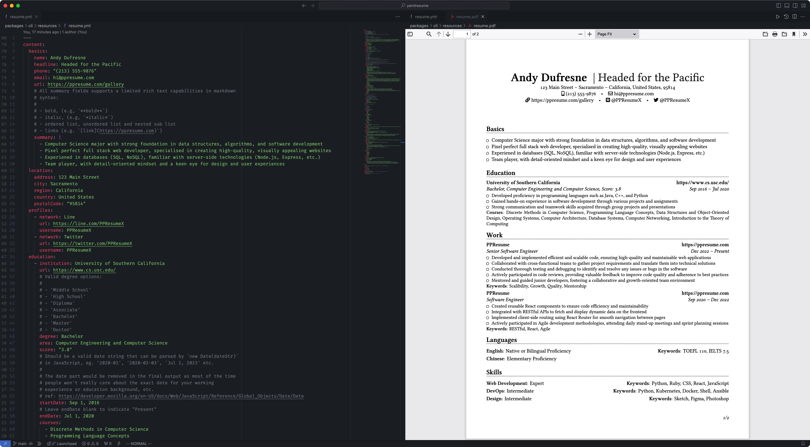
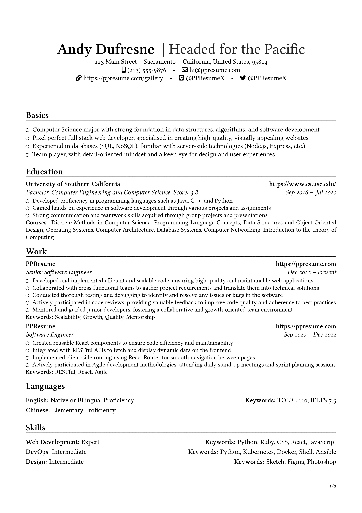
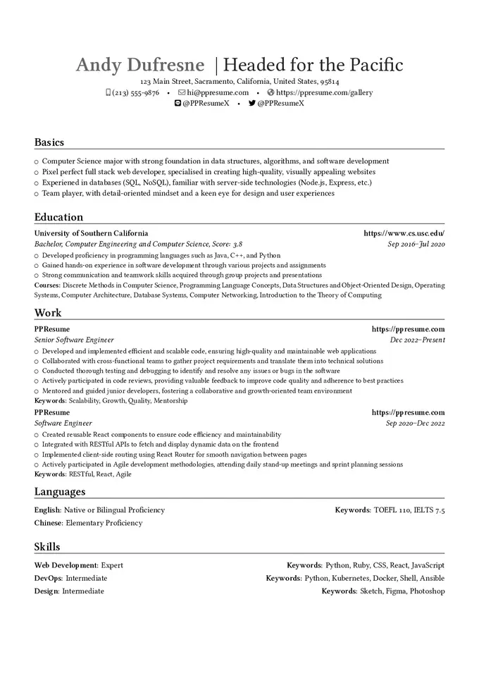
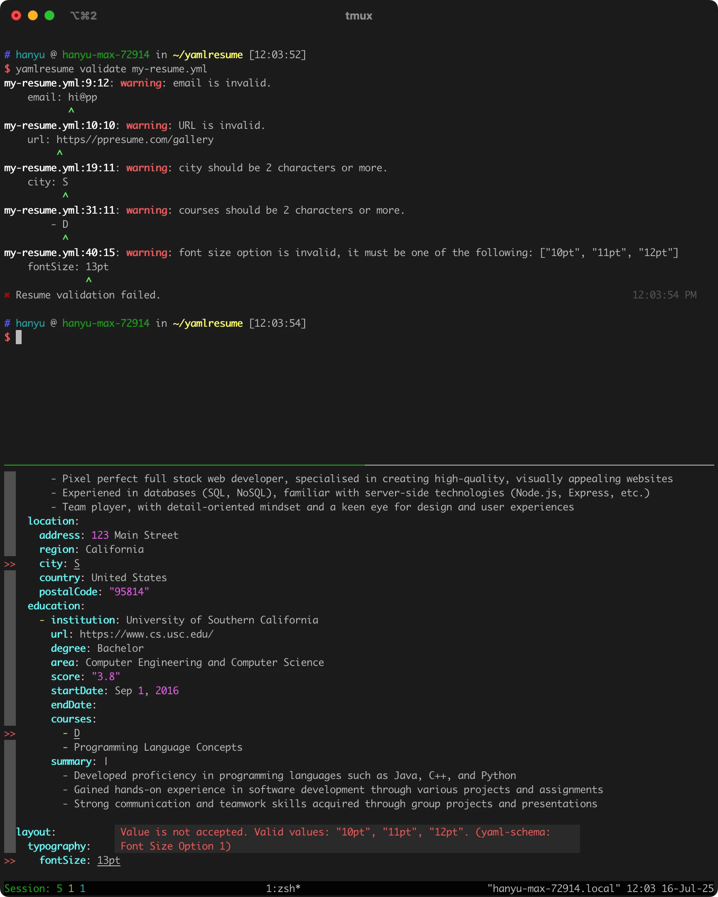

# YAMLResume

[English](../README.md) | [Français](./README-fr.md) | [Deutsch](./README-de.md) | [Español](./README-es.md) | [Português](./README-pt.md) | [Bahasa Indonesia](./README-id.md) | [日本語](./README-ja.md) | [简体中文](./README-zh-cn.md) | [繁體中文](./README-zh-tw.md)

**Currículos como código.** Escriba su currículo en YAML de texto plano,
versiónelo con Git y compílelo en PDF, HTML, Markdown y DOCX con precisión de
píxel — con un solo comando.

[](https://github.com/yamlresume/yamlresume/actions/workflows/test.yml)
[](https://www.npmjs.com/package/yamlresume)
[](https://www.npmjs.com/package/yamlresume)
[](https://github.com/yamlresume/yamlresume)
[](https://yamlresume.dev)
[](../LICENSE)

> **Novedades:**
> [YAMLResume v0.18](https://github.com/yamlresume/yamlresume/releases) incorpora
> el motor Typst, junto con currículos de ejemplo seleccionados en 13
> localizaciones y generación y traducción asistidas por IA. Consulte también la
> [GitHub Action YAMLResume](https://github.com/marketplace/actions/yamlresume)
> para automatizar la generación de PDF en CI/CD.



## Por qué YAMLResume

- **El formato no es su trabajo.** Su contenido permanece separado de la
  presentación; el compilador se encarga de fuentes, espaciado, márgenes y saltos
  de página.
- **Su currículo se vuelve revisable.** Diff, blame, ramas y revert de un
  currículo igual que con código. Cada versión es un commit.
- **Un archivo, todos los formatos.** Los reclutadores quieren PDF, algunos
  portales DOCX, su sitio web HTML. Cambie una sección y todos se actualizan
  juntos.
- **Los errores fallan temprano y fuerte.** Un esquema estricto detecta una fecha
  incorrecta o una sección mal escrita antes de enviarlo, no después de la
  entrevista.

## Inicio Rápido

Pruébelo sin instalar nada en el
[Playground](https://yamlresume.dev/playground) — sin instalación, sin LaTeX,
vista previa en vivo.

Desde la línea de comandos, `npx` le da un currículo funcional en dos comandos:

```sh
npx yamlresume new resume.yml   # genera un currículo completo y válido
npx yamlresume build resume.yml # compila cada diseño configurado
```

La salida PDF de LaTeX necesita un motor TeX en su máquina. Sin uno, añada
`--no-pdf` para obtener HTML, Markdown y DOCX igualmente, o use la imagen Docker
de abajo, que incluye todo.

<details>
<summary>Instalar de forma permanente (npm, pnpm, yarn, bun, Homebrew, Docker)</summary>

Se requiere Node.js >= 22 para las instalaciones mediante gestores de paquetes:

```sh
# npm
npm install -g yamlresume

# pnpm
pnpm add -g yamlresume

# yarn
yarn global add yamlresume

# bun
bun add -g yamlresume

# Homebrew (macOS)
brew install yamlresume
```

La imagen Docker incluye la CLI, XeTeX, Typst y las fuentes recomendadas, así que
no hace falta instalar nada más:

```sh
docker run --rm -v $(pwd):/home/yamlresume yamlresume/yamlresume new my-resume.yml
docker run --rm -v $(pwd):/home/yamlresume yamlresume/yamlresume build my-resume.yml
```

[](https://asciinema.org/a/722057)

</details>

La salida PDF necesita un motor de composición (XeTeX o Typst). Compruebe qué le
falta a su máquina:

```sh
yamlresume doctor
```

Para la configuración completa, incluida la instalación de motores y fuentes,
consulte la [guía de instalación](https://yamlresume.dev/docs/installation).

## Su currículo es solo YAML

Sin formato propietario, sin base de datos, sin cuenta:

```yml
# yaml-language-server: $schema=https://yamlresume.dev/schema.json
content:
  basics:
    name: Andy Dufresne
    headline: Backend Engineer
    email: andy@example.com
    summary: Backend engineer with 6 years building distributed systems.
  work:
    - name: PPResume
      position: Senior Engineer
      startDate: Jan 2022
      summary: Rewrote the typesetting engine; cut p99 latency by 40%.
  education:
    - institution: University of Southern California
      area: Computer Science
      degree: Bachelor
```

Esa línea `yaml-language-server` es toda la historia del editor: activa el
autocompletado, la documentación al pasar el cursor y la validación en línea en
VS Code, Neovim, JetBrains o cualquier otro editor basado en el
[servidor de lenguaje YAML](https://github.com/redhat-developer/yaml-language-server).

Compílelo:

```sh
$ yamlresume build resume.yml
✔ Generated resume html file successfully: resume.html
✔ Generated resume tex file successfully: resume.tex
◐ Generating resume pdf file with command: xelatex -halt-on-error resume.tex...
✔ Generated resume pdf file successfully: resume.tex.pdf
✔ Generated resume docx file successfully: resume.docx
✔ Generated resume markdown file successfully: resume.md
✔ Generated resume typ file successfully: resume.typ
◐ Generating resume pdf file with command: typst compile resume.typ resume.typ.pdf...
✔ Generated resume pdf file successfully: resume.typ.pdf
```

Dos PDF porque los diseños por defecto habilitan ambos motores PDF; desactive uno
en `layouts:` y el otro conserva el nombre simple `resume.pdf`.

O una recompilación en cada guardado, como un servidor de desarrollo web:

```sh
yamlresume dev resume.yml
```

Vea el resultado: [PDF](../docs/static/images/resume.pdf) ·
[página 1](../docs/static/images/resume-1.webp) ·
[página 2](../docs/static/images/resume-2.webp)




¿Prefiere empezar con algo real? `yamlresume new --sample <id>` genera uno de 20
currículos seleccionados, y `yamlresume samples list` muestra lo disponible.

## Características en Resumen

- **Una fuente, cinco motores.** LaTeX, Typst, HTML, Markdown y DOCX desde un
  único `resume.yml`.
- **Un compilador de currículos real.** Analizar, validar, transformar, renderizar
  — con validación en tiempo de ejecución de Zod e integración de JSON Schema en
  el editor.
- **Excelente experiencia de desarrollo.** `yamlresume dev` para el modo watch,
  `yamlresume doctor` para diagnóstico del entorno, `yamlresume validate` para
  errores al estilo clang.
- **Generación y traducción asistidas por IA.** Cree un currículo a partir de un
  cargo, o traduzca uno existente, sin editar el YAML a mano.
- **Global por defecto.** 11 idiomas en 13 códigos de localización, más
  tipografía, tamaño de papel y orden de secciones por plantilla.

## Plantillas

Nueve plantillas en cinco motores. Cada vista previa es el mismo currículo y el
mismo YAML, renderizados por un motor distinto — haga clic para abrirlo en la
[galería](https://yamlresume.dev/gallery/templates).

<table>
<tr>
<td align="center" width="33%">
<a href="https://yamlresume.dev/gallery/templates/latex/jake"></a>
<br><b>Jake</b> · LaTeX
<br><sub>Sencilla, directa, una sola columna</sub>
</td>
<td align="center" width="33%">
<a href="https://yamlresume.dev/gallery/templates/latex/moderncv-banking"></a>
<br><b>ModernCV Banking</b> · LaTeX
<br><sub>El estilo bancario conservador de ModernCV</sub>
</td>
<td align="center" width="33%">
<a href="https://yamlresume.dev/gallery/templates/latex/moderncv-casual"></a>
<br><b>ModernCV Casual</b> · LaTeX
<br><sub>El estilo desenfadado y menos formal de ModernCV</sub>
</td>
</tr>
<tr>
<td align="center" width="33%">
<a href="https://yamlresume.dev/gallery/templates/latex/moderncv-classic"></a>
<br><b>ModernCV Classic</b> · LaTeX
<br><sub>El diseño clásico de ModernCV</sub>
</td>
<td align="center" width="33%">
<a href="https://yamlresume.dev/gallery/templates/typst/jake"></a>
<br><b>Jake</b> · Typst
<br><sub>El diseño de Jake, renderizado con Typst</sub>
</td>
<td align="center" width="33%">
<a href="https://yamlresume.dev/gallery/templates/html/calm"></a>
<br><b>Calm</b> · HTML
<br><sub>Limpia y minimalista, para todos los profesionales</sub>
</td>
</tr>
<tr>
<td align="center" width="33%">
<a href="https://yamlresume.dev/gallery/templates/html/kami"></a>
<br><b>Kami</b> · HTML
<br><sub>Pergamino cálido, una sola voz serif</sub>
</td>
<td align="center" width="33%">
<a href="https://yamlresume.dev/gallery/templates/html/vscode"></a>
<br><b>VS Code</b> · HTML
<br><sub>Tema oscuro para currículos de desarrolladores</sub>
</td>
<td align="center" width="33%">
<a href="https://yamlresume.dev/gallery/templates/docx/calm"></a>
<br><b>Calm</b> · DOCX
<br><sub>Archivo Word editable, mismo diseño limpio</sub>
</td>
</tr>
</table>

Ejecute `yamlresume templates list` para ver lo que incluye su instalación, y
`yamlresume build` para renderizar cada diseño configurado.

Las plantillas son solo el punto de partida — tipografía, márgenes, tamaño de
papel, iconos y orden de secciones son configurables por diseño.

## Un currículo, muchos diseños

Los diseños separan su contenido de la presentación. Declare tantos formatos de
salida como necesite:

```yml
layouts:
  - engine: latex
    template: moderncv-banking
    typography:
      fontSize: 11pt
  - engine: typst
    template: jake
  - engine: markdown
  - engine: html
    template: calm
  - engine: docx
    template: calm
```

Obtenga más información sobre cada motor:
[LaTeX / PDF](https://yamlresume.dev/docs/layouts/latex) ·
[Typst / PDF](https://yamlresume.dev/docs/layouts/typst) ·
[HTML](https://yamlresume.dev/docs/layouts/html) ·
[Markdown](https://yamlresume.dev/docs/layouts/markdown) ·
[DOCX](https://yamlresume.dev/docs/layouts/docx)

## Validando Currículos

Ejecute `yamlresume validate resume.yml` para diagnósticos al estilo compilador,
en su terminal y en CI:



El esquema en sí se publica en
[yamlresume.dev/schema.json](https://yamlresume.dev/schema.json). Consulte la
[documentación del esquema](https://yamlresume.dev/docs/compiler/schema) para más
detalles.

## Generación asistida por IA

Genere un punto de partida completo y compatible con el esquema a partir de un
cargo e idioma:

```sh
export OPENAI_API_KEY=sk-...
yamlresume ai generate --position "Software Engineer" --language en resume.yml
```

O traduzca un currículo existente a otra localización sin tocar el YAML:

```sh
yamlresume ai translate resume.yml resume-ja.yml --to ja
```

Los proveedores soportados incluyen OpenAI, DeepSeek, Kimi y Ollama. Consulte la
[documentación de IA](https://yamlresume.dev/docs/ai) para los detalles de
configuración.

## Idiomas

La localización está integrada. Defina su localización en `resume.yml`, o ejecute
`yamlresume languages list`:

```yml
locale:
  language: en
```

Soportados: inglés, chino simplificado, chino tradicional (Hong Kong y Taiwán),
español, francés, italiano, noruego, neerlandés, japonés, alemán, indonesio y
portugués brasileño — 11 idiomas en 13 códigos de localización. Consulte la
[documentación de Locale](https://yamlresume.dev/docs/locale) para la lista
completa.

## Ecosistema

| Paquete | Qué hace |
| ------- | -------- |
| [`yamlresume`](https://www.npmjs.com/package/yamlresume) | La CLI: build, dev, validate, generate, translate. |
| [`@yamlresume/ai`](https://www.npmjs.com/package/@yamlresume/ai) | Generación de currículos asistida por IA, programática. |
| [`@yamlresume/playground`](https://www.npmjs.com/package/@yamlresume/playground) | Componente React integrable de editor y vista previa. |
| [`@yamlresume/samples`](https://www.npmjs.com/package/@yamlresume/samples) | Currículos de ejemplo seleccionados en 13 localizaciones. |
| [`create-yamlresume`](https://yamlresume.dev/docs/ecosystem/create-yamlresume) | Crear un proyecto nuevo con un comando. |
| [`json2yamlresume`](https://yamlresume.dev/docs/ecosystem/json2yamlresume) | Convertir archivos [JSON Resume](https://jsonresume.org/) a YAML. |
| [`yamlresume/action`](https://github.com/marketplace/actions/yamlresume) | Compilar currículos en GitHub Actions. |
| [Docker](https://hub.docker.com/r/yamlresume/yamlresume) / [Homebrew](https://formulae.brew.sh/formula/yamlresume) | Instalar sin una cadena de herramientas local. |

## FAQ

<details>
<summary>¿Necesito instalar LaTeX?</summary>

Solo para la salida PDF de LaTeX. HTML, Markdown y DOCX no necesitan nada más
allá de Node.js, y el [Playground](https://yamlresume.dev/playground) los
renderiza en el navegador. Para PDF sin una cadena de herramientas local, use la
imagen Docker, que incluye XeTeX, Typst y fuentes.
</details>

<details>
<summary>¿Por qué falla <code>build</code> con <code>xelatex: command not found</code>?</summary>

No hay ninguna distribución TeX en su `PATH`. Ejecute `yamlresume doctor` para un
informe por dependencia, luego siga la
[guía de instalación](https://yamlresume.dev/docs/installation), o elimine el
diseño LaTeX y compile con Typst.
</details>

<details>
<summary>¿Puedo usar mi JSON Resume existente?</summary>

Sí — `npx json2yamlresume` convierte un archivo
[JSON Resume](https://jsonresume.org/) al formato YAMLResume.
</details>

<details>
<summary>¿Cómo reconstruyo mi currículo automáticamente?</summary>

Añada la
[GitHub Action](https://github.com/marketplace/actions/yamlresume) a un flujo de
trabajo, o use `yamlresume dev resume.yml` en local para recompilar al guardar.
En ambos casos el PDF es un artefacto de compilación, nunca un archivo editado a
mano.
</details>

## Contribuyendo

YAMLResume está en desarrollo activo y nuevas características se agregan
regularmente. Las contribuciones son muy bienvenidas — por favor, lea las
[pautas](../CONTRIBUTING.md) antes de enviar un pull request.

```sh
pnpm install
pnpm build   # los paquetes importan desde el dist compilado
pnpm test
pnpm check   # Biome + tsc
```

Herramientas: TypeScript, [Biome](https://biomejs.dev/) para lint y formato,
[Vitest](https://vitest.dev/) para pruebas con umbrales de cobertura del 100 %,
espacios de trabajo PNPM y [Conventional Commits](https://conventionalcommits.org).
Las fórmulas de Docker y Homebrew se construyen desde este repositorio, así que
los cambios de empaquetado también van aquí.

[](https://www.typescriptlang.org/)
[](https://pnpm.io/)
[](https://biomejs.dev/)
[](https://vitest.dev/)
[](https://conventionalcommits.org)
[](https://discord.gg/9SyT7mVV4K)

### Historial de Estrellas

[](https://www.star-history.com/?repos=yamlresume%2Fyamlresume&type=date&legend=top-left)

## Hoja de Ruta

- [ ] más plantillas de currículos
- [ ] más idiomas y localizaciones
- [ ] características de optimización para ATS

## Principio de Diseño

Este proyecto comenzó como el motor de composición tipográfica central para
[PPResume](https://ppresume.com/?ref=yamlresume), un generador de currículos
basado en LaTeX con precisión de píxel. Tras una cuidadosa consideración,
decidimos hacerlo de código abierto para que todos siempre puedan
[decir no al bloqueo de proveedor](https://blog.ppresume.com/posts/no-vendor-lock-in).

YAMLResume sigue el principio de
[separación de responsabilidades](https://es.wikipedia.org/wiki/Separaci%C3%B3n_de_responsabilidades):

- **Contenido** se almacena en YAML de texto plano.
- **Estructura y validación** son impuestas por el compilador y un esquema estricto.
- **Presentación** es manejada por motores de diseño intercambiables (LaTeX, Typst, HTML,
  Markdown, DOCX).

Usted edita el qué; YAMLResume se encarga del cómo.

## Apoye el Proyecto

Si YAMLResume le resulta útil, considere apoyar el proyecto:

[](https://buymeacoffee.com/xiaohanyu)
