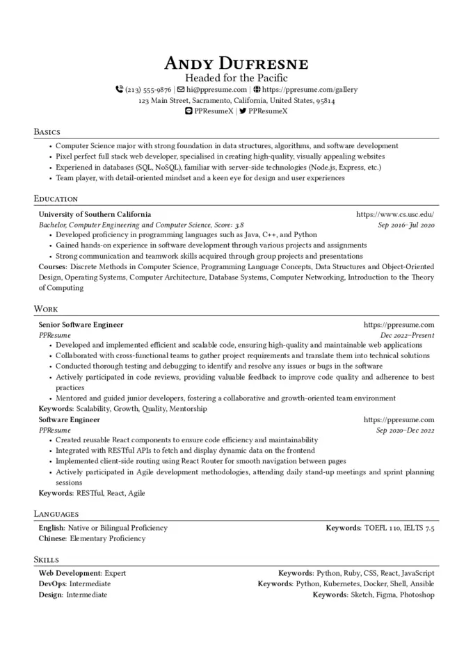

# YAMLResume

[English](../README.md) | [Français](./README-fr.md) | [Deutsch](./README-de.md) | [Español](./README-es.md) | [Português](./README-pt.md) | [Bahasa Indonesia](./README-id.md) | [日本語](./README-ja.md) | [简体中文](./README-zh-cn.md) | [繁體中文](./README-zh-tw.md)

**Resume sebagai kode.** Tulis resume Anda dalam YAML teks biasa, versikan dengan
Git, dan kompilasi menjadi PDF, HTML, Markdown, serta DOCX yang presisi piksel —
dalam satu perintah.

[](https://github.com/yamlresume/yamlresume/actions/workflows/test.yml)
[](https://www.npmjs.com/package/yamlresume)
[](https://www.npmjs.com/package/yamlresume)
[](https://github.com/yamlresume/yamlresume)
[](https://yamlresume.dev)
[](../LICENSE)

> **Kabar:** [YAMLResume v0.18](https://github.com/yamlresume/yamlresume/releases)
> menghadirkan mesin Typst, bersama contoh resume terkurasi dalam 13 locale serta
> pembuatan dan penerjemahan resume bertenaga AI. Lihat juga
> [YAMLResume GitHub Action](https://github.com/marketplace/actions/yamlresume)
> untuk mengotomatiskan pembuatan PDF di CI/CD.


## Mengapa YAMLResume

- **Pemformatan bukan tugas Anda.** Konten Anda tetap terpisah dari tampilan;
  kompiler yang menangani font, spasi, margin, dan pemenggalan halaman.
- **Resume Anda menjadi dapat ditinjau.** Diff, blame, branch, dan revert resume
  seperti Anda melakukannya pada kode. Setiap versi adalah commit.
- **Satu berkas, semua format.** Perekrut menginginkan PDF, sebagian portal
  menginginkan DOCX, situs Anda menginginkan HTML. Ubah satu bagian dan semuanya
  ikut diperbarui.
- **Kesalahan gagal lebih awal dan jelas.** Skema yang ketat menangkap tanggal
  yang salah atau bagian yang salah eja sebelum Anda mengirimnya, bukan setelah
  wawancara.

## Mulai Cepat

Coba tanpa perlu memasang apa pun di
[Playground](https://yamlresume.dev/playground) — tanpa instalasi, tanpa LaTeX,
pratinjau langsung.

Dari baris perintah, `npx` memberi Anda resume yang berfungsi dalam dua perintah:

```sh
npx yamlresume new resume.yml   # buat resume lengkap dan valid
npx yamlresume build resume.yml # kompilasi semua tata letak yang dikonfigurasi
```

Keluaran PDF LaTeX memerlukan mesin TeX di mesin Anda. Tanpanya, tambahkan
`--no-pdf` untuk tetap mendapatkan HTML, Markdown, dan DOCX, atau gunakan image
Docker di bawah yang sudah menyertakan semuanya.

<details>
<summary>Pasang secara permanen (npm, pnpm, yarn, bun, Homebrew, Docker)</summary>

Node.js >= 22 diperlukan untuk pemasangan via pengelola paket:

```sh
# npm
npm install -g yamlresume

# pnpm
pnpm add -g yamlresume

# yarn
yarn global add yamlresume

# bun
bun add -g yamlresume

# Homebrew (macOS)
brew install yamlresume
```

Image Docker menyertakan CLI, XeTeX, Typst, dan font yang direkomendasikan, jadi
tidak ada yang perlu dipasang lagi:

```sh
docker run --rm -v $(pwd):/home/yamlresume yamlresume/yamlresume new my-resume.yml
docker run --rm -v $(pwd):/home/yamlresume yamlresume/yamlresume build my-resume.yml
```

[](https://asciinema.org/a/722057)

</details>

Keluaran PDF memerlukan mesin tata letak (XeTeX atau Typst). Periksa apa yang
belum ada di mesin Anda:

```sh
yamlresume doctor
```

Untuk penyiapan lengkap, termasuk pemasangan mesin dan font, lihat
[panduan pemasangan](https://yamlresume.dev/docs/installation).

## Resume Anda hanyalah YAML

Tanpa format proprietary, tanpa basis data, tanpa akun:

```yml
# yaml-language-server: $schema=https://yamlresume.dev/schema.json
content:
  basics:
    name: Andy Dufresne
    headline: Backend Engineer
    email: andy@example.com
    summary: Backend engineer with 6 years building distributed systems.
  work:
    - name: PPResume
      position: Senior Engineer
      startDate: Jan 2022
      summary: Rewrote the typesetting engine; cut p99 latency by 40%.
  education:
    - institution: University of Southern California
      area: Computer Science
      degree: Bachelor
```

Baris `yaml-language-server` itu adalah seluruh cerita editor: baris tersebut
mengaktifkan pelengkapan otomatis, dokumentasi saat melayang, dan validasi
inline di VS Code, Neovim, JetBrains, atau apa pun yang didukung
[server bahasa YAML](https://github.com/redhat-developer/yaml-language-server).

Kompilasi:

```sh
$ yamlresume build resume.yml
✔ Generated resume html file successfully: resume.html
✔ Generated resume tex file successfully: resume.tex
◐ Generating resume pdf file with command: xelatex -halt-on-error resume.tex...
✔ Generated resume pdf file successfully: resume.tex.pdf
✔ Generated resume docx file successfully: resume.docx
✔ Generated resume markdown file successfully: resume.md
✔ Generated resume typ file successfully: resume.typ
◐ Generating resume pdf file with command: typst compile resume.typ resume.typ.pdf...
✔ Generated resume pdf file successfully: resume.typ.pdf
```

Dua PDF karena tata letak default mengaktifkan kedua mesin PDF; nonaktifkan salah
satu di `layouts:` dan yang lain mempertahankan nama sederhana `resume.pdf`.

Atau bangun ulang setiap kali menyimpan, seperti server pengembangan web:

```sh
yamlresume dev resume.yml
```

Lihat hasilnya: [PDF](../docs/static/images/resume.pdf) ·
[halaman 1](../docs/static/images/resume-1.webp) ·
[halaman 2](../docs/static/images/resume-2.webp)


Ingin mulai dari sesuatu yang nyata? `yamlresume new --sample <id>` membuat salah
satu dari 20 resume terkurasi, dan `yamlresume samples list` menampilkan apa yang
tersedia.

## Fitur Sekilas

- **Satu sumber, lima mesin.** LaTeX, Typst, HTML, Markdown, dan DOCX dari satu
  `resume.yml`.
- **Kompiler resume sesungguhnya.** Parsing, validasi, transformasi, render —
  dengan validasi runtime Zod dan integrasi JSON Schema di editor.
- **Pengalaman pengembang yang sangat baik.** `yamlresume dev` untuk mode watch,
  `yamlresume doctor` untuk diagnosis lingkungan, `yamlresume validate` untuk
  kesalahan bergaya clang.
- **Pembuatan dan penerjemahan bertenaga AI.** Buat resume dari jabatan, atau
  terjemahkan resume yang sudah ada, tanpa mengedit YAML secara manual.
- **Global secara bawaan.** 11 bahasa dalam 13 kode locale, plus tipografi,
  ukuran kertas, dan urutan bagian per templat.

## Templat

Sembilan templat di lima mesin. Setiap pratinjau di bawah adalah resume dan YAML
yang sama, dirender oleh mesin berbeda — klik untuk membukanya di
[galeri](https://yamlresume.dev/gallery/templates).

<table>
<tr>
<td align="center" width="33%">
<a href="https://yamlresume.dev/gallery/templates/latex/jake"></a>
<br><b>Jake</b> · LaTeX
<br><sub>Sederhana, lugas, satu kolom</sub>
</td>
<td align="center" width="33%">
<a href="https://yamlresume.dev/gallery/templates/latex/moderncv-banking"></a>
<br><b>ModernCV Banking</b> · LaTeX
<br><sub>Gaya perbankan konservatif dari ModernCV</sub>
</td>
<td align="center" width="33%">
<a href="https://yamlresume.dev/gallery/templates/latex/moderncv-casual"></a>
<br><b>ModernCV Casual</b> · LaTeX
<br><sub>Gaya santai ModernCV yang lebih tidak formal</sub>
</td>
</tr>
<tr>
<td align="center" width="33%">
<a href="https://yamlresume.dev/gallery/templates/latex/moderncv-classic"></a>
<br><b>ModernCV Classic</b> · LaTeX
<br><sub>Tata letak klasik ModernCV</sub>
</td>
<td align="center" width="33%">
<a href="https://yamlresume.dev/gallery/templates/typst/jake"></a>
<br><b>Jake</b> · Typst
<br><sub>Tata letak Jake, dirender dengan Typst</sub>
</td>
<td align="center" width="33%">
<a href="https://yamlresume.dev/gallery/templates/html/calm"></a>
<br><b>Calm</b> · HTML
<br><sub>Rapi dan minimalis, untuk semua profesional</sub>
</td>
</tr>
<tr>
<td align="center" width="33%">
<a href="https://yamlresume.dev/gallery/templates/html/kami"></a>
<br><b>Kami</b> · HTML
<br><sub>Perkamen hangat, satu suara serif</sub>
</td>
<td align="center" width="33%">
<a href="https://yamlresume.dev/gallery/templates/html/vscode"></a>
<br><b>VS Code</b> · HTML
<br><sub>Tema gelap untuk resume pengembang</sub>
</td>
<td align="center" width="33%">
<a href="https://yamlresume.dev/gallery/templates/docx/calm"></a>
<br><b>Calm</b> · DOCX
<br><sub>Berkas Word yang dapat diedit, tata letak rapi yang sama</sub>
</td>
</tr>
</table>

Jalankan `yamlresume templates list` untuk melihat apa yang disertakan instalasi
Anda, dan `yamlresume build` untuk merender setiap tata letak yang dikonfigurasi.

Templat hanyalah titik awal — tipografi, margin, ukuran kertas, ikon, dan urutan
bagian semuanya dapat dikonfigurasi per tata letak.

## Satu resume, banyak tata letak

Tata letak memisahkan konten Anda dari penyajiannya. Nyatakan sebanyak apa pun
format keluaran yang Anda butuhkan:

```yml
layouts:
  - engine: latex
    template: moderncv-banking
    typography:
      fontSize: 11pt
  - engine: typst
    template: jake
  - engine: markdown
  - engine: html
    template: calm
  - engine: docx
    template: calm
```

Pelajari lebih lanjut tiap mesin:
[LaTeX / PDF](https://yamlresume.dev/docs/layouts/latex) ·
[Typst / PDF](https://yamlresume.dev/docs/layouts/typst) ·
[HTML](https://yamlresume.dev/docs/layouts/html) ·
[Markdown](https://yamlresume.dev/docs/layouts/markdown) ·
[DOCX](https://yamlresume.dev/docs/layouts/docx)

## Memvalidasi Resume

Jalankan `yamlresume validate resume.yml` untuk diagnosis bergaya kompiler, di
terminal maupun di CI:


Skemanya sendiri dipublikasikan di
[yamlresume.dev/schema.json](https://yamlresume.dev/schema.json). Lihat
[dokumentasi skema](https://yamlresume.dev/docs/compiler/schema) untuk detail.

## Pembuatan bertenaga AI

Hasilkan titik awal lengkap yang patuh skema dari jabatan dan bahasa:

```sh
export OPENAI_API_KEY=sk-...
yamlresume ai generate --position "Software Engineer" --language en resume.yml
```

Atau terjemahkan resume yang sudah ada ke locale lain tanpa menyentuh YAML:

```sh
yamlresume ai translate resume.yml resume-ja.yml --to ja
```

Penyedia yang didukung mencakup OpenAI, DeepSeek, Kimi, dan Ollama. Lihat
[dokumentasi AI](https://yamlresume.dev/docs/ai) untuk detail penyiapan.

## Bahasa

Pelokalan sudah bawaan. Tetapkan locale Anda di `resume.yml`, atau jalankan
`yamlresume languages list`:

```yml
locale:
  language: en
```

Didukung: Inggris, Tionghoa Sederhana, Tionghoa Tradisional (Hong Kong dan
Taiwan), Spanyol, Prancis, Italia, Norwegia, Belanda, Jepang, Jerman, Indonesia,
dan Portugis Brasil — 11 bahasa dalam 13 kode locale. Lihat
[dokumentasi Locale](https://yamlresume.dev/docs/locale) untuk daftar lengkap.

## Ekosistem

| Paket | Fungsinya |
| ----- | --------- |
| [`yamlresume`](https://www.npmjs.com/package/yamlresume) | CLI: build, dev, validate, generate, translate. |
| [`@yamlresume/ai`](https://www.npmjs.com/package/@yamlresume/ai) | Pembuatan resume bertenaga AI secara terprogram. |
| [`@yamlresume/playground`](https://www.npmjs.com/package/@yamlresume/playground) | Komponen React editor dan pratinjau yang dapat disematkan. |
| [`@yamlresume/samples`](https://www.npmjs.com/package/@yamlresume/samples) | Contoh resume terkurasi dalam 13 locale. |
| [`create-yamlresume`](https://yamlresume.dev/docs/ecosystem/create-yamlresume) | Membuat proyek baru dalam satu perintah. |
| [`json2yamlresume`](https://yamlresume.dev/docs/ecosystem/json2yamlresume) | Mengonversi berkas [JSON Resume](https://jsonresume.org/) ke YAML. |
| [`yamlresume/action`](https://github.com/marketplace/actions/yamlresume) | Membangun resume di GitHub Actions. |
| [Docker](https://hub.docker.com/r/yamlresume/yamlresume) / [Homebrew](https://formulae.brew.sh/formula/yamlresume) | Memasang tanpa toolchain lokal. |

## FAQ

<details>
<summary>Apakah saya perlu memasang LaTeX?</summary>

Hanya untuk keluaran PDF LaTeX. HTML, Markdown, dan DOCX tidak memerlukan apa pun
selain Node.js, dan [Playground](https://yamlresume.dev/playground) merendernya di
peramban. Untuk PDF tanpa toolchain lokal, gunakan image Docker yang menyertakan
XeTeX, Typst, dan font.
</details>

<details>
<summary>Mengapa <code>build</code> gagal dengan <code>xelatex: command not found</code>?</summary>

Tidak ada distribusi TeX di `PATH` Anda. Jalankan `yamlresume doctor` untuk
laporan per dependensi, lalu ikuti
[panduan pemasangan](https://yamlresume.dev/docs/installation), atau hapus tata
letak LaTeX dan bangun dengan Typst.
</details>

<details>
<summary>Bisakah saya memakai JSON Resume yang sudah ada?</summary>

Bisa — `npx json2yamlresume` mengonversi berkas
[JSON Resume](https://jsonresume.org/) ke format YAMLResume.
</details>

<details>
<summary>Bagaimana cara membangun ulang resume saya secara otomatis?</summary>

Tambahkan
[GitHub Action](https://github.com/marketplace/actions/yamlresume) ke workflow,
atau gunakan `yamlresume dev resume.yml` secara lokal untuk bangun ulang saat
menyimpan. Dengan cara apa pun PDF adalah artefak build, bukan berkas yang
diedit manual.
</details>

## Berkontribusi

YAMLResume sedang dalam pengembangan aktif dan fitur baru ditambahkan secara
berkala. Kontribusi sangat dihargai — silakan baca
[panduan](../CONTRIBUTING.md) sebelum mengirimkan pull request.

```sh
pnpm install
pnpm build   # paket mengimpor dari dist hasil build
pnpm test
pnpm check   # Biome + tsc
```

Perkakas: TypeScript, [Biome](https://biomejs.dev/) untuk lint dan format,
[Vitest](https://vitest.dev/) untuk pengujian dengan ambang cakupan 100 %,
workspace PNPM, dan [Conventional Commits](https://conventionalcommits.org).
Formula Docker dan Homebrew dibangun dari repo ini, jadi perubahan pengemasan
juga berada di sini.

[](https://www.typescriptlang.org/)
[](https://pnpm.io/)
[](https://biomejs.dev/)
[](https://vitest.dev/)
[](https://conventionalcommits.org)
[](https://discord.gg/9SyT7mVV4K)

### Riwayat Bintang

[](https://www.star-history.com/?repos=yamlresume%2Fyamlresume&type=date&legend=top-left)

## Peta Jalan

- [ ] lebih banyak templat resume
- [ ] lebih banyak bahasa dan locale
- [ ] fitur optimasi ATS

## Prinsip Desain

Proyek ini bermula sebagai mesin tata letak inti untuk
[PPResume](https://ppresume.com/?ref=yamlresume), pembangkit resume berbasis
LaTeX yang sangat presisi. Setelah pertimbangan matang, kami memutuskan untuk
membukanya agar semua orang selalu bisa
[menolak kunci vendor](https://blog.ppresume.com/posts/no-vendor-lock-in).

YAMLResume mengikuti prinsip
[pemisahan kepentingan](https://id.wikipedia.org/wiki/Pemisahan_kepentingan):

- **Konten** disimpan dalam YAML teks biasa.
- **Struktur dan validasi** ditegakkan oleh kompiler dan skema yang ketat.
- **Tampilan** ditangani oleh mesin tata letak yang dapat dipertukarkan (LaTeX, Typst,
  HTML, Markdown, DOCX).

Anda mengedit isinya; YAMLResume yang mengurus cara penyajiannya.

## Dukung Proyek Ini

Jika YAMLResume bermanfaat bagi Anda, pertimbangkan untuk mendukung proyek ini:

[](https://buymeacoffee.com/xiaohanyu)
