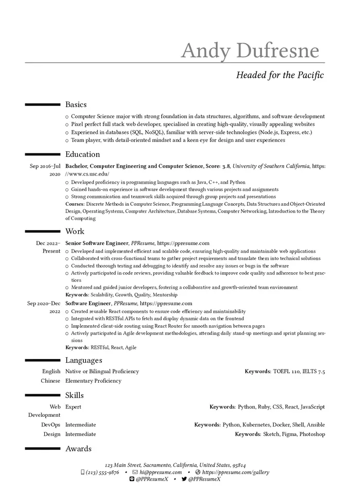
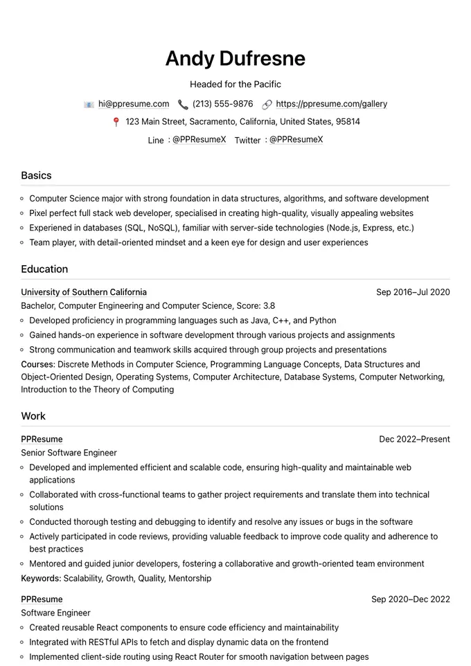
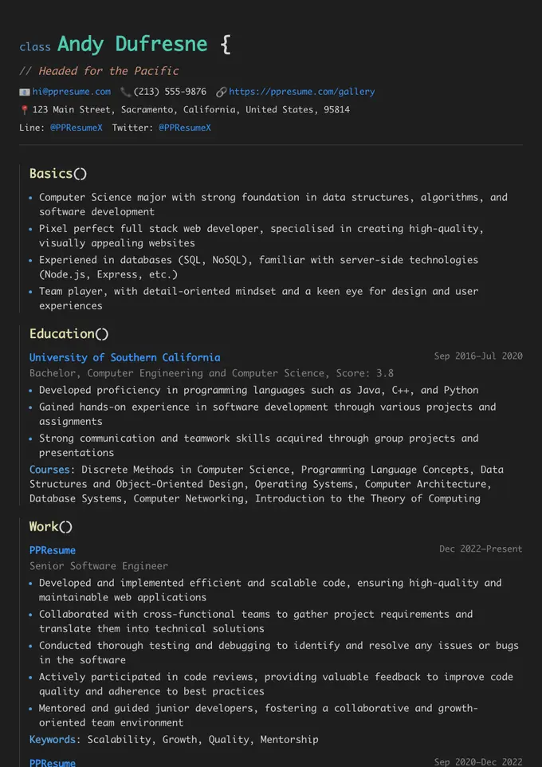
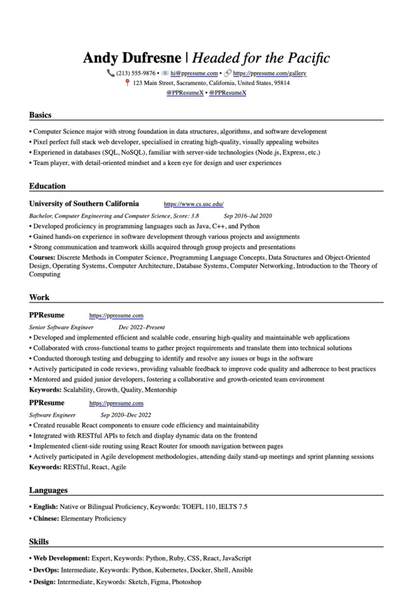

# YAMLResume

[English](../README.md) | [Français](./README-fr.md) | [Deutsch](./README-de.md) | [Español](./README-es.md) | [Português](./README-pt.md) | [Bahasa Indonesia](./README-id.md) | [日本語](./README-ja.md) | [简体中文](./README-zh-cn.md) | [繁體中文](./README-zh-tw.md)

**Currículos como código.** Escreva seu currículo em YAML de texto puro,
versione-o com Git e compile-o em PDF, HTML, Markdown e DOCX com precisão de
pixel — em um único comando.

[](https://github.com/yamlresume/yamlresume/actions/workflows/test.yml)
[](https://www.npmjs.com/package/yamlresume)
[](https://www.npmjs.com/package/yamlresume)
[](https://github.com/yamlresume/yamlresume)
[](https://yamlresume.dev)
[](../LICENSE)

> **Novidades:**
> [YAMLResume v0.18](https://github.com/yamlresume/yamlresume/releases) traz o
> motor Typst, além de currículos de exemplo selecionados em 13 locales e
> geração e tradução assistidas por IA. Confira também a
> [GitHub Action YAMLResume](https://github.com/marketplace/actions/yamlresume)
> para automatizar a geração de PDF em CI/CD.


## Por que YAMLResume

- **Formatação não é seu trabalho.** Seu conteúdo permanece separado da
  apresentação; o compilador cuida de fontes, espaçamento, margens e quebras de
  página.
- **Seu currículo se torna revisável.** Diff, blame, branch e revert de um
  currículo como você faz com código. Cada versão é um commit.
- **Um arquivo, todos os formatos.** Recrutadores querem PDF, alguns portais
  querem DOCX, seu site quer HTML. Mude uma seção e todos se atualizam juntos.
- **Erros falham cedo e alto.** Um esquema estrito detecta uma data errada ou uma
  seção escrita incorretamente antes de você enviar, não depois da entrevista.

## Início Rápido

Experimente sem instalar nada no
[Playground](https://yamlresume.dev/playground) — sem instalação, sem LaTeX,
pré-visualização ao vivo.

Pela linha de comando, o `npx` entrega um currículo funcional em dois comandos:

```sh
npx yamlresume new resume.yml   # gera um currículo completo e válido
npx yamlresume build resume.yml # compila cada layout configurado
```

A saída PDF em LaTeX precisa de um motor TeX na sua máquina. Sem um, adicione
`--no-pdf` para obter HTML, Markdown e DOCX mesmo assim, ou use a imagem Docker
abaixo, que inclui tudo.

<details>
<summary>Instalar permanentemente (npm, pnpm, yarn, bun, Homebrew, Docker)</summary>

Node.js >= 22 é necessário para as instalações via gerenciador de pacotes:

```sh
# npm
npm install -g yamlresume

# pnpm
pnpm add -g yamlresume

# yarn
yarn global add yamlresume

# bun
bun add -g yamlresume

# Homebrew (macOS)
brew install yamlresume
```

A imagem Docker inclui a CLI, XeTeX, Typst e as fontes recomendadas, então nada
mais precisa ser instalado:

```sh
docker run --rm -v $(pwd):/home/yamlresume yamlresume/yamlresume new my-resume.yml
docker run --rm -v $(pwd):/home/yamlresume yamlresume/yamlresume build my-resume.yml
```

[](https://asciinema.org/a/722057)

</details>

A saída PDF precisa de um motor de composição (XeTeX ou Typst). Verifique o que
falta na sua máquina:

```sh
yamlresume doctor
```

Para a configuração completa, incluindo instalação de motores e fontes, consulte
o [guia de instalação](https://yamlresume.dev/docs/installation).

## Seu currículo é só YAML

Sem formato proprietário, sem banco de dados, sem conta:

```yml
# yaml-language-server: $schema=https://yamlresume.dev/schema.json
content:
  basics:
    name: Andy Dufresne
    headline: Backend Engineer
    email: andy@example.com
    summary: Backend engineer with 6 years building distributed systems.
  work:
    - name: PPResume
      position: Senior Engineer
      startDate: Jan 2022
      summary: Rewrote the typesetting engine; cut p99 latency by 40%.
  education:
    - institution: University of Southern California
      area: Computer Science
      degree: Bachelor
```

Essa linha `yaml-language-server` é toda a história do editor: ela ativa
autocompletar, documentação ao passar o mouse e validação em linha no VS Code,
Neovim, JetBrains ou qualquer outro editor baseado no
[servidor de linguagem YAML](https://github.com/redhat-developer/yaml-language-server).

Compile:

```sh
$ yamlresume build resume.yml
✔ Generated resume html file successfully: resume.html
✔ Generated resume tex file successfully: resume.tex
◐ Generating resume pdf file with command: xelatex -halt-on-error resume.tex...
✔ Generated resume pdf file successfully: resume.tex.pdf
✔ Generated resume docx file successfully: resume.docx
✔ Generated resume markdown file successfully: resume.md
✔ Generated resume typ file successfully: resume.typ
◐ Generating resume pdf file with command: typst compile resume.typ resume.typ.pdf...
✔ Generated resume pdf file successfully: resume.typ.pdf
```

Dois PDFs porque os layouts padrão ativam ambos os motores PDF; desative um em
`layouts:` e o outro mantém o nome simples `resume.pdf`.

Ou uma recompilação a cada salvamento, como um servidor de desenvolvimento web:

```sh
yamlresume dev resume.yml
```

Veja o resultado: [PDF](../docs/static/images/resume.pdf) ·
[página 1](../docs/static/images/resume-1.webp) ·
[página 2](../docs/static/images/resume-2.webp)


Prefere começar de algo real? `yamlresume new --sample <id>` gera um dos 20
currículos selecionados, e `yamlresume samples list` mostra o que está
disponível.

## Funcionalidades em Resumo

- **Uma fonte, cinco motores.** LaTeX, Typst, HTML, Markdown e DOCX a partir de
  um único `resume.yml`.
- **Um compilador de currículo real.** Analisar, validar, transformar, renderizar
  — com validação em tempo de execução do Zod e integração de JSON Schema no
  editor.
- **Excelente experiência de desenvolvimento.** `yamlresume dev` para modo watch,
  `yamlresume doctor` para diagnóstico de ambiente, `yamlresume validate` para
  erros no estilo clang.
- **Geração e tradução assistidas por IA.** Crie um currículo a partir de um
  cargo, ou traduza um existente, sem editar o YAML à mão.
- **Global por padrão.** 11 idiomas em 13 códigos de locale, além de tipografia,
  tamanho de papel e ordem de seções por modelo.

## Modelos

Nove modelos em cinco motores. Cada pré-visualização abaixo é o mesmo currículo e
o mesmo YAML, renderizados por um motor diferente — clique para abrir na
[galeria](https://yamlresume.dev/gallery/templates).

<table>
<tr>
<td align="center" width="33%">
<a href="https://yamlresume.dev/gallery/templates/latex/jake"></a>
<br><b>Jake</b> · LaTeX
<br><sub>Simples, direto, coluna única</sub>
</td>
<td align="center" width="33%">
<a href="https://yamlresume.dev/gallery/templates/latex/moderncv-banking"></a>
<br><b>ModernCV Banking</b> · LaTeX
<br><sub>O estilo bancário conservador do ModernCV</sub>
</td>
<td align="center" width="33%">
<a href="https://yamlresume.dev/gallery/templates/latex/moderncv-casual"></a>
<br><b>ModernCV Casual</b> · LaTeX
<br><sub>O estilo descontraído e menos formal do ModernCV</sub>
</td>
</tr>
<tr>
<td align="center" width="33%">
<a href="https://yamlresume.dev/gallery/templates/latex/moderncv-classic"></a>
<br><b>ModernCV Classic</b> · LaTeX
<br><sub>O layout clássico do ModernCV</sub>
</td>
<td align="center" width="33%">
<a href="https://yamlresume.dev/gallery/templates/typst/jake"></a>
<br><b>Jake</b> · Typst
<br><sub>O layout do Jake, renderizado com Typst</sub>
</td>
<td align="center" width="33%">
<a href="https://yamlresume.dev/gallery/templates/html/calm"></a>
<br><b>Calm</b> · HTML
<br><sub>Limpo e minimalista, para todos os profissionais</sub>
</td>
</tr>
<tr>
<td align="center" width="33%">
<a href="https://yamlresume.dev/gallery/templates/html/kami"></a>
<br><b>Kami</b> · HTML
<br><sub>Pergaminho quente, uma única voz serif</sub>
</td>
<td align="center" width="33%">
<a href="https://yamlresume.dev/gallery/templates/html/vscode"></a>
<br><b>VS Code</b> · HTML
<br><sub>Tema escuro para currículos de desenvolvedores</sub>
</td>
<td align="center" width="33%">
<a href="https://yamlresume.dev/gallery/templates/docx/calm"></a>
<br><b>Calm</b> · DOCX
<br><sub>Arquivo Word editável, mesmo layout limpo</sub>
</td>
</tr>
</table>

Execute `yamlresume templates list` para ver o que sua instalação inclui, e
`yamlresume build` para renderizar cada layout configurado.

Modelos são apenas o ponto de partida — tipografia, margens, tamanho de papel,
ícones e ordem das seções são configuráveis por layout.

## Um currículo, muitos layouts

Layouts separam seu conteúdo da apresentação. Declare quantos formatos de saída
precisar:

```yml
layouts:
  - engine: latex
    template: moderncv-banking
    typography:
      fontSize: 11pt
  - engine: typst
    template: jake
  - engine: markdown
  - engine: html
    template: calm
  - engine: docx
    template: calm
```

Saiba mais sobre cada motor:
[LaTeX / PDF](https://yamlresume.dev/docs/layouts/latex) ·
[Typst / PDF](https://yamlresume.dev/docs/layouts/typst) ·
[HTML](https://yamlresume.dev/docs/layouts/html) ·
[Markdown](https://yamlresume.dev/docs/layouts/markdown) ·
[DOCX](https://yamlresume.dev/docs/layouts/docx)

## Validando Currículos

Execute `yamlresume validate resume.yml` para diagnósticos no estilo compilador,
no seu terminal e em CI:


O esquema em si é publicado em
[yamlresume.dev/schema.json](https://yamlresume.dev/schema.json). Consulte a
[documentação do esquema](https://yamlresume.dev/docs/compiler/schema) para
detalhes.

## Geração assistida por IA

Gere um ponto de partida completo e compatível com o esquema a partir de um cargo
e idioma:

```sh
export OPENAI_API_KEY=sk-...
yamlresume ai generate --position "Software Engineer" --language en resume.yml
```

Ou traduza um currículo existente para outro locale sem tocar no YAML:

```sh
yamlresume ai translate resume.yml resume-ja.yml --to ja
```

Os provedores suportados incluem OpenAI, DeepSeek, Kimi e Ollama. Consulte a
[documentação de IA](https://yamlresume.dev/docs/ai) para detalhes de
configuração.

## Idiomas

A localização é integrada. Defina seu locale em `resume.yml`, ou execute
`yamlresume languages list`:

```yml
locale:
  language: en
```

Suportados: inglês, chinês simplificado, chinês tradicional (Hong Kong e Taiwan),
espanhol, francês, italiano, norueguês, holandês, japonês, alemão, indonésio e
português brasileiro — 11 idiomas em 13 códigos de locale. Consulte a
[documentação de Locale](https://yamlresume.dev/docs/locale) para a lista
completa.

## Ecossistema

| Pacote | O que faz |
| ------ | --------- |
| [`yamlresume`](https://www.npmjs.com/package/yamlresume) | A CLI: build, dev, validate, generate, translate. |
| [`@yamlresume/ai`](https://www.npmjs.com/package/@yamlresume/ai) | Geração de currículo assistida por IA, programática. |
| [`@yamlresume/playground`](https://www.npmjs.com/package/@yamlresume/playground) | Componente React incorporável de editor e pré-visualização. |
| [`@yamlresume/samples`](https://www.npmjs.com/package/@yamlresume/samples) | Currículos de exemplo selecionados em 13 locales. |
| [`create-yamlresume`](https://yamlresume.dev/docs/ecosystem/create-yamlresume) | Criar um novo projeto com um comando. |
| [`json2yamlresume`](https://yamlresume.dev/docs/ecosystem/json2yamlresume) | Converter arquivos [JSON Resume](https://jsonresume.org/) em YAML. |
| [`yamlresume/action`](https://github.com/marketplace/actions/yamlresume) | Compilar currículos no GitHub Actions. |
| [Docker](https://hub.docker.com/r/yamlresume/yamlresume) / [Homebrew](https://formulae.brew.sh/formula/yamlresume) | Instalar sem uma toolchain local. |

## FAQ

<details>
<summary>Preciso instalar LaTeX?</summary>

Apenas para a saída PDF em LaTeX. HTML, Markdown e DOCX não precisam de nada
além do Node.js, e o [Playground](https://yamlresume.dev/playground) os renderiza
no navegador. Para PDF sem uma toolchain local, use a imagem Docker, que inclui
XeTeX, Typst e fontes.
</details>

<details>
<summary>Por que <code>build</code> falha com <code>xelatex: command not found</code>?</summary>

Nenhuma distribuição TeX no seu `PATH`. Execute `yamlresume doctor` para um
relatório por dependência, depois siga o
[guia de instalação](https://yamlresume.dev/docs/installation), ou remova o
layout LaTeX e compile com Typst.
</details>

<details>
<summary>Posso usar meu JSON Resume existente?</summary>

Sim — `npx json2yamlresume` converte um arquivo
[JSON Resume](https://jsonresume.org/) para o formato YAMLResume.
</details>

<details>
<summary>Como reconstruo meu currículo automaticamente?</summary>

Adicione a
[GitHub Action](https://github.com/marketplace/actions/yamlresume) a um workflow,
ou use `yamlresume dev resume.yml` localmente para recompilar ao salvar. De
qualquer forma o PDF é um artefato de build, nunca um arquivo editado à mão.
</details>

## Contribuindo

O YAMLResume está em desenvolvimento ativo e novas funcionalidades são adicionadas
regularmente. Contribuições são extremamente bem-vindas — por favor, leia as
[diretrizes](../CONTRIBUTING.md) antes de enviar um pull request.

```sh
pnpm install
pnpm build   # os pacotes importam do dist compilado
pnpm test
pnpm check   # Biome + tsc
```

Ferramentas: TypeScript, [Biome](https://biomejs.dev/) para lint e formatação,
[Vitest](https://vitest.dev/) para testes com limites de cobertura de 100 %,
workspaces PNPM e [Conventional Commits](https://conventionalcommits.org).
As fórmulas Docker e Homebrew são construídas a partir deste repositório, então
mudanças de empacotamento também pertencem aqui.

[](https://www.typescriptlang.org/)
[](https://pnpm.io/)
[](https://biomejs.dev/)
[](https://vitest.dev/)
[](https://conventionalcommits.org)
[](https://discord.gg/9SyT7mVV4K)

### Histórico de Estrelas

[](https://www.star-history.com/?repos=yamlresume%2Fyamlresume&type=date&legend=top-left)

## Roadmap

- [ ] mais modelos de currículo
- [ ] mais idiomas e locales
- [ ] funcionalidades de otimização para ATS

## Princípio de Design

Este projeto começou como o motor de composição tipográfica base para o
[PPResume](https://ppresume.com/?ref=yamlresume), um gerador de currículo baseado
em LaTeX com precisão de pixel. Após consideração cuidadosa, decidimos torná-lo
open source para que todos sempre possam
[dizer não ao vendor lock-in](https://blog.ppresume.com/posts/no-vendor-lock-in).

O YAMLResume segue o princípio de
[separação de responsabilidades](https://pt.wikipedia.org/wiki/Separa%C3%A7%C3%A3o_de_responsabilidades):

- **Conteúdo** é armazenado em YAML texto puro.
- **Estrutura e validação** são impostas pelo compilador e um esquema rígido.
- **Apresentação** é tratada por motores de layout intercambiáveis (LaTeX, Typst, HTML,
  Markdown, DOCX).

Você edita o quê; o YAMLResume cuida do como.

## Apoie o Projeto

Se o YAMLResume é útil para você, considere apoiar o projeto:

[](https://buymeacoffee.com/xiaohanyu)
