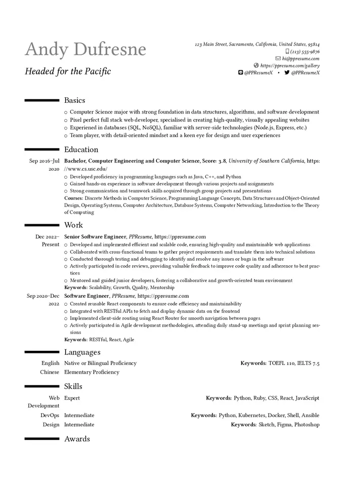

# YAMLResume

[English](../README.md) | [Français](./README-fr.md) | [Deutsch](./README-de.md) | [Español](./README-es.md) | [Português](./README-pt.md) | [Bahasa Indonesia](./README-id.md) | [日本語](./README-ja.md) | [简体中文](./README-zh-cn.md) | [繁體中文](./README-zh-tw.md)

**简历即代码。** 用纯文本 YAML 编写简历，用 Git 管理版本，一条命令即可编译为
像素级精确的 PDF、HTML、Markdown 和 DOCX。

[](https://github.com/yamlresume/yamlresume/actions/workflows/test.yml)
[](https://www.npmjs.com/package/yamlresume)
[](https://www.npmjs.com/package/yamlresume)
[](https://github.com/yamlresume/yamlresume)
[](https://yamlresume.dev/zh-cn)
[](../LICENSE)

> **最新消息：**
> [YAMLResume v0.18](https://github.com/yamlresume/yamlresume/releases) 已发布，
> 带来 Typst 引擎，以及覆盖 13 个语言环境的精选简历样本和 AI 驱动的生成与翻译。
> 另请查看
> [YAMLResume GitHub Action](https://github.com/marketplace/actions/yamlresume)，
> 在 CI/CD 中自动生成 PDF。


## 为什么选择 YAMLResume

- **排版不是你的工作。** 内容与呈现分离；字体、间距、页边距和分页都由编译器负责。
- **简历变得可评审。** 像对待代码一样对简历做 diff、blame、branch 和 revert。
  每个版本都是一次提交。
- **一个文件，所有格式。** 招聘方想要 PDF，有些平台想要 DOCX，你的网站想要 HTML。
  修改一个章节，所有格式同步更新。
- **错误会尽早、明确地暴露。** 严格的模式会在你投递之前——而不是面试之后——
  发现错误的日期或拼写错误的章节。

## 快速开始

在 [Playground](https://yamlresume.dev/playground) 中零配置试用——无需安装，
无需 LaTeX，实时预览。

在命令行中，`npx` 用两条命令就能得到一份可用的简历：

```sh
npx yamlresume new resume.yml   # 生成一份完整、有效的简历
npx yamlresume build resume.yml # 编译所有已配置的布局
```

LaTeX PDF 输出需要本地安装 TeX 引擎。如果没有，加上 `--no-pdf` 仍可获得 HTML、
Markdown 和 DOCX，或者使用下方已打包全部依赖的 Docker 镜像。

<details>
<summary>永久安装（npm、pnpm、yarn、bun、Homebrew、Docker）</summary>

通过包管理器安装需要 Node.js >= 22：

```sh
# npm
npm install -g yamlresume

# pnpm
pnpm add -g yamlresume

# yarn
yarn global add yamlresume

# bun
bun add -g yamlresume

# Homebrew (macOS)
brew install yamlresume
```

Docker 镜像打包了 CLI、XeTeX、Typst 和推荐字体，无需安装其他任何东西：

```sh
docker run --rm -v $(pwd):/home/yamlresume yamlresume/yamlresume new my-resume.yml
docker run --rm -v $(pwd):/home/yamlresume yamlresume/yamlresume build my-resume.yml
```

[](https://asciinema.org/a/722057)

</details>

PDF 输出需要排版引擎（XeTeX 或 Typst）。检查你的机器缺少什么：

```sh
yamlresume doctor
```

完整安装步骤（包括引擎和字体安装）请参阅
[安装指南](https://yamlresume.dev/zh-cn/docs/installation)。

## 简历就是一个 YAML 文件

没有专有格式，没有数据库，没有账号：

```yml
# yaml-language-server: $schema=https://yamlresume.dev/schema.json
content:
  basics:
    name: Andy Dufresne
    headline: Backend Engineer
    email: andy@example.com
    summary: Backend engineer with 6 years building distributed systems.
  work:
    - name: PPResume
      position: Senior Engineer
      startDate: Jan 2022
      summary: Rewrote the typesetting engine; cut p99 latency by 40%.
  education:
    - institution: University of Southern California
      area: Computer Science
      degree: Bachelor
```

那行 `yaml-language-server` 就是全部的编辑器配置：它在 VS Code、Neovim、JetBrains
或任何基于
[YAML language server](https://github.com/redhat-developer/yaml-language-server)
的编辑器中开启自动补全、悬停文档和实时校验。

编译它：

```sh
$ yamlresume build resume.yml
✔ Generated resume html file successfully: resume.html
✔ Generated resume tex file successfully: resume.tex
◐ Generating resume pdf file with command: xelatex -halt-on-error resume.tex...
✔ Generated resume pdf file successfully: resume.tex.pdf
✔ Generated resume docx file successfully: resume.docx
✔ Generated resume markdown file successfully: resume.md
✔ Generated resume typ file successfully: resume.typ
◐ Generating resume pdf file with command: typst compile resume.typ resume.typ.pdf...
✔ Generated resume pdf file successfully: resume.typ.pdf
```

产生两个 PDF 是因为默认布局同时启用了两个 PDF 引擎；在 `layouts:` 中停用其中一个，
另一个就会保留简单的 `resume.pdf` 名称。

或者像 Web 开发服务器那样，每次保存都重新构建：

```sh
yamlresume dev resume.yml
```

查看结果：[PDF](../docs/static/images/resume.pdf) ·
[第 1 页](../docs/static/images/resume-1.webp) ·
[第 2 页](../docs/static/images/resume-2.webp)


想从真实的例子开始？`yamlresume new --sample <id>` 可生成 20 份精选简历之一，
`yamlresume samples list` 显示可用的样本。

## 功能概览

- **一个源，五个引擎。** 从单个 `resume.yml` 生成 LaTeX、Typst、HTML、Markdown
  和 DOCX。
- **真正的简历编译器。** 解析、验证、转换、渲染——配合 Zod 运行时校验和编辑器中的
  JSON Schema 集成。
- **卓越的开发者体验。** `yamlresume dev` 提供监视模式，`yamlresume doctor`
  提供环境诊断，`yamlresume validate` 提供 clang 风格的错误。
- **AI 驱动的生成与翻译。** 从职位名称生成简历，或翻译已有简历，无需手工编辑 YAML。
- **默认面向全球。** 11 种语言、13 个语言环境代码，并按模板配置排版、纸张尺寸和
  章节顺序。

## 模板

五个引擎共九个模板。下面每个预览都是同一份简历和同一份 YAML，由不同引擎渲染
而成——点击可在[画廊](https://yamlresume.dev/zh-cn/gallery/templates)中打开。

<table>
<tr>
<td align="center" width="33%">
<a href="https://yamlresume.dev/zh-cn/gallery/templates/latex/jake"></a>
<br><b>Jake</b> · LaTeX
<br><sub>简洁直接的单栏布局</sub>
</td>
<td align="center" width="33%">
<a href="https://yamlresume.dev/zh-cn/gallery/templates/latex/moderncv-banking"></a>
<br><b>ModernCV Banking</b> · LaTeX
<br><sub>ModernCV 保守的银行风格</sub>
</td>
<td align="center" width="33%">
<a href="https://yamlresume.dev/zh-cn/gallery/templates/latex/moderncv-casual"></a>
<br><b>ModernCV Casual</b> · LaTeX
<br><sub>ModernCV 轻松、不那么正式的风格</sub>
</td>
</tr>
<tr>
<td align="center" width="33%">
<a href="https://yamlresume.dev/zh-cn/gallery/templates/latex/moderncv-classic"></a>
<br><b>ModernCV Classic</b> · LaTeX
<br><sub>ModernCV 经典布局</sub>
</td>
<td align="center" width="33%">
<a href="https://yamlresume.dev/zh-cn/gallery/templates/typst/jake"></a>
<br><b>Jake</b> · Typst
<br><sub>用 Typst 渲染的 Jake 布局</sub>
</td>
<td align="center" width="33%">
<a href="https://yamlresume.dev/zh-cn/gallery/templates/html/calm"></a>
<br><b>Calm</b> · HTML
<br><sub>干净极简，适合所有职业</sub>
</td>
</tr>
<tr>
<td align="center" width="33%">
<a href="https://yamlresume.dev/zh-cn/gallery/templates/html/kami"></a>
<br><b>Kami</b> · HTML
<br><sub>温暖的羊皮纸色调，单一衬线字体</sub>
</td>
<td align="center" width="33%">
<a href="https://yamlresume.dev/zh-cn/gallery/templates/html/vscode"></a>
<br><b>VS Code</b> · HTML
<br><sub>面向开发者的深色主题简历</sub>
</td>
<td align="center" width="33%">
<a href="https://yamlresume.dev/zh-cn/gallery/templates/docx/calm"></a>
<br><b>Calm</b> · DOCX
<br><sub>可编辑的 Word 文件，同样干净的布局</sub>
</td>
</tr>
</table>

运行 `yamlresume templates list` 查看你的安装包含哪些模板，运行
`yamlresume build` 渲染所有已配置的布局。

模板只是起点——排版、页边距、纸张尺寸、图标和章节顺序都可以按布局配置。

## 一份简历，多种布局

布局将内容与呈现分离。按需声明任意数量的输出格式：

```yml
layouts:
  - engine: latex
    template: moderncv-banking
    typography:
      fontSize: 11pt
  - engine: typst
    template: jake
  - engine: markdown
  - engine: html
    template: calm
  - engine: docx
    template: calm
```

了解每种引擎的更多信息：
[LaTeX / PDF](https://yamlresume.dev/zh-cn/docs/layouts/latex) ·
[Typst / PDF](https://yamlresume.dev/zh-cn/docs/layouts/typst) ·
[HTML](https://yamlresume.dev/zh-cn/docs/layouts/html) ·
[Markdown](https://yamlresume.dev/zh-cn/docs/layouts/markdown) ·
[DOCX](https://yamlresume.dev/zh-cn/docs/layouts/docx)

## 验证简历

在终端和 CI 中运行 `yamlresume validate resume.yml` 获取编译器风格的诊断信息：


模式本身发布在
[yamlresume.dev/schema.json](https://yamlresume.dev/schema.json)。详情请参阅
[模式文档](https://yamlresume.dev/zh-cn/docs/compiler/schema)。

## AI 驱动的生成

从职位和语言生成一份完整、符合模式的起点：

```sh
export OPENAI_API_KEY=sk-...
yamlresume ai generate --position "Software Engineer" --language en resume.yml
```

或者在不改动 YAML 的情况下，将现有简历翻译成其他语言环境：

```sh
yamlresume ai translate resume.yml resume-ja.yml --to ja
```

支持的提供商包括 OpenAI、DeepSeek、Kimi 和 Ollama。配置详情请参阅
[AI 文档](https://yamlresume.dev/zh-cn/docs/ai)。

## 语言

本地化内建其中。在 `resume.yml` 中设置语言环境，或运行
`yamlresume languages list`：

```yml
locale:
  language: en
```

支持：英语、简体中文、繁体中文（香港和台湾）、西班牙语、法语、意大利语、挪威语、
荷兰语、日语、德语、印尼语和巴西葡萄牙语——11 种语言、13 个语言环境代码。完整列表
请参阅 [Locale 文档](https://yamlresume.dev/zh-cn/docs/locale)。

## 生态系统

| 包 | 作用 |
| -- | ---- |
| [`yamlresume`](https://www.npmjs.com/package/yamlresume) | CLI：build、dev、validate、generate、translate。 |
| [`@yamlresume/ai`](https://www.npmjs.com/package/@yamlresume/ai) | 可编程的 AI 驱动简历生成。 |
| [`@yamlresume/playground`](https://www.npmjs.com/package/@yamlresume/playground) | 可嵌入的 React 编辑器与预览组件。 |
| [`@yamlresume/samples`](https://www.npmjs.com/package/@yamlresume/samples) | 覆盖 13 个语言环境的精选简历样本。 |
| [`create-yamlresume`](https://yamlresume.dev/zh-cn/docs/ecosystem/create-yamlresume) | 一条命令创建新项目。 |
| [`json2yamlresume`](https://yamlresume.dev/zh-cn/docs/ecosystem/json2yamlresume) | 将 [JSON Resume](https://jsonresume.org/) 文件转换为 YAML。 |
| [`yamlresume/action`](https://github.com/marketplace/actions/yamlresume) | 在 GitHub Actions 中构建简历。 |
| [Docker](https://hub.docker.com/r/yamlresume/yamlresume) / [Homebrew](https://formulae.brew.sh/formula/yamlresume) | 无需本地工具链即可安装。 |

## 常见问题

<details>
<summary>需要安装 LaTeX 吗？</summary>

只有 LaTeX PDF 输出需要。HTML、Markdown 和 DOCX 除 Node.js 外无需任何东西，
[Playground](https://yamlresume.dev/playground) 可在浏览器中渲染它们。若要在没有
本地工具链的情况下获得 PDF，请使用打包了 XeTeX、Typst 和字体的 Docker 镜像。
</details>

<details>
<summary>为什么 <code>build</code> 报 <code>xelatex: command not found</code>？</summary>

你的 `PATH` 中没有 TeX 发行版。运行 `yamlresume doctor` 获取逐项依赖报告，然后
按照[安装指南](https://yamlresume.dev/zh-cn/docs/installation)操作，或者去掉 LaTeX
布局改用 Typst 构建。
</details>

<details>
<summary>可以使用现有的 JSON Resume 吗？</summary>

可以——`npx json2yamlresume` 可将
[JSON Resume](https://jsonresume.org/) 文件转换为 YAMLResume 格式。
</details>

<details>
<summary>如何自动重建简历？</summary>

将 [GitHub Action](https://github.com/marketplace/actions/yamlresume) 添加到工作流，
或在本地使用 `yamlresume dev resume.yml` 实现保存即重建。两种方式下 PDF 都是构建
产物，绝不是手工编辑的文件。
</details>

## 参与贡献

YAMLResume 正在积极开发中，新功能定期添加。非常欢迎贡献——请在提交 Pull Request
之前阅读[贡献指南](../CONTRIBUTING.md)。

```sh
pnpm install
pnpm build   # 包从构建后的 dist 导入
pnpm test
pnpm check   # Biome + tsc
```

工具链：TypeScript、[Biome](https://biomejs.dev/)（lint 与格式化）、
[Vitest](https://vitest.dev/)（测试，100% 覆盖率门槛）、PNPM workspaces 和
[Conventional Commits](https://conventionalcommits.org)。Docker 和 Homebrew 公式从
本仓库构建，因此打包相关的改动也属于这里。

[](https://www.typescriptlang.org/)
[](https://pnpm.io/)
[](https://biomejs.dev/)
[](https://vitest.dev/)
[](https://conventionalcommits.org)
[](https://discord.gg/9SyT7mVV4K)

### 星标历史

[](https://www.star-history.com/?repos=yamlresume%2Fyamlresume&type=date&legend=top-left)

## 路线图

- [ ] 更多简历模板
- [ ] 更多语言和语言环境
- [ ] ATS 优化功能

## 设计理念

该项目最初是 [PPResume](https://ppresume.com/?ref=yamlresume) 的核心排版引擎。
PPResume 是一个基于 LaTeX 的像素级精确简历生成器。经过深思熟虑，我们决定将其开源，
让每个人都能
[对供应商锁定说不](https://blog.ppresume.com/posts/no-vendor-lock-in)。

YAMLResume 遵循
[关注点分离](https://zh.wikipedia.org/wiki/%E5%85%B3%E6%B3%A8%E7%82%B9%E5%88%86%E7%A6%BB)
原则：

- **内容** 存储在纯文本 YAML 中。
- **结构和验证** 由编译器和严格的模式强制执行。
- **呈现方式** 由可互换的布局引擎（LaTeX、Typst、HTML、Markdown、DOCX）处理。

您编辑"什么"；YAMLResume 负责"如何"呈现。

## 支持项目

如果您觉得 YAMLResume 对您有帮助，请考虑支持该项目：

[](https://buymeacoffee.com/xiaohanyu)
