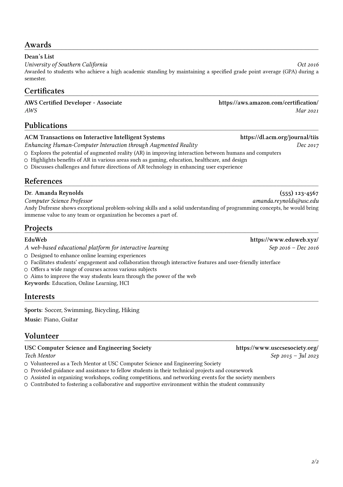
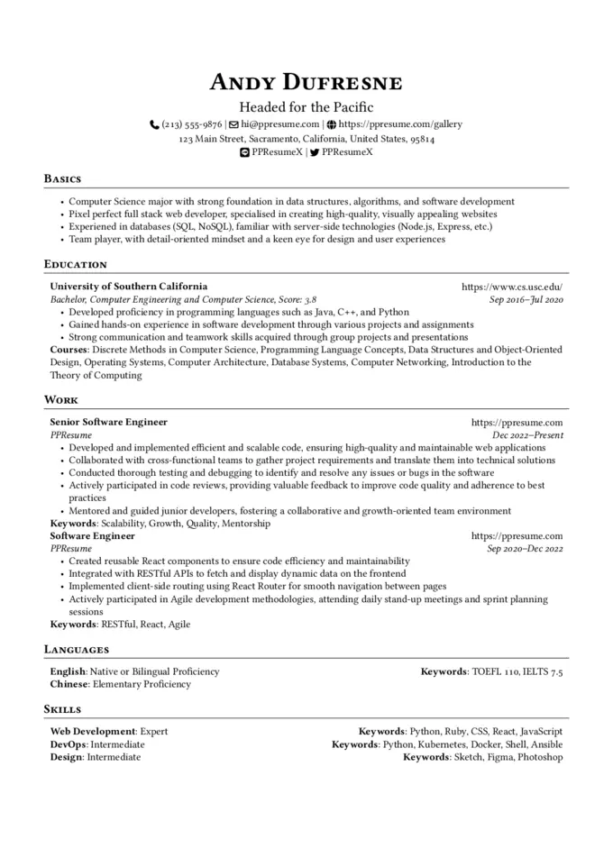

# YAMLResume

[English](../README.md) | [Français](./README-fr.md) | [Deutsch](./README-de.md) | [Español](./README-es.md) | [Português](./README-pt.md) | [Bahasa Indonesia](./README-id.md) | [日本語](./README-ja.md) | [简体中文](./README-zh-cn.md) | [繁體中文](./README-zh-tw.md)

**履歷即程式碼。** 用純文字 YAML 撰寫履歷，用 Git 管理版本，一條命令即可編譯為
像素級精確的 PDF、HTML、Markdown 和 DOCX。

[](https://github.com/yamlresume/yamlresume/actions/workflows/test.yml)
[](https://www.npmjs.com/package/yamlresume)
[](https://www.npmjs.com/package/yamlresume)
[](https://github.com/yamlresume/yamlresume)
[](https://yamlresume.dev/zh-tw)
[](../LICENSE)

> **最新消息：**
> [YAMLResume v0.18](https://github.com/yamlresume/yamlresume/releases) 已發布，
> 帶來 Typst 引擎，以及涵蓋 13 個語言環境的精選履歷範本和 AI 驅動的生成與翻譯。
> 另請查看
> [YAMLResume GitHub Action](https://github.com/marketplace/actions/yamlresume)，
> 在 CI/CD 中自動生成 PDF。


## 為什麼選擇 YAMLResume

- **排版不是你的工作。** 內容與呈現分離；字型、間距、頁邊距和分頁都由編譯器負責。
- **履歷變得可審閱。** 像對待程式碼一樣對履歷做 diff、blame、branch 和 revert。
  每個版本都是一次提交。
- **一個檔案，所有格式。** 招募方想要 PDF，有些平台想要 DOCX，你的網站想要 HTML。
  修改一個章節，所有格式同步更新。
- **錯誤會儘早、明確地暴露。** 嚴格的模式會在你投遞之前——而不是面試之後——
  發現錯誤的日期或拼寫錯誤的章節。

## 快速開始

在 [Playground](https://yamlresume.dev/playground) 中零設定試用——無需安裝，
無需 LaTeX，即時預覽。

在命令列中，`npx` 用兩條命令就能得到一份可用的履歷：

```sh
npx yamlresume new resume.yml   # 產生一份完整、有效的履歷
npx yamlresume build resume.yml # 編譯所有已設定的佈局
```

LaTeX PDF 輸出需要本機安裝 TeX 引擎。如果沒有，加上 `--no-pdf` 仍可取得 HTML、
Markdown 和 DOCX，或使用下方已打包全部相依項的 Docker 映像。

<details>
<summary>永久安裝（npm、pnpm、yarn、bun、Homebrew、Docker）</summary>

透過套件管理器安裝需要 Node.js >= 22：

```sh
# npm
npm install -g yamlresume

# pnpm
pnpm add -g yamlresume

# yarn
yarn global add yamlresume

# bun
bun add -g yamlresume

# Homebrew (macOS)
brew install yamlresume
```

Docker 映像打包了 CLI、XeTeX、Typst 和推薦字型，無需安裝其他任何東西：

```sh
docker run --rm -v $(pwd):/home/yamlresume yamlresume/yamlresume new my-resume.yml
docker run --rm -v $(pwd):/home/yamlresume yamlresume/yamlresume build my-resume.yml
```

[](https://asciinema.org/a/722057)

</details>

PDF 輸出需要排版引擎（XeTeX 或 Typst）。檢查你的機器缺少什麼：

```sh
yamlresume doctor
```

完整安裝步驟（包括引擎和字型安裝）請參閱
[安裝指南](https://yamlresume.dev/zh-tw/docs/installation)。

## 履歷就是一個 YAML 檔案

沒有專有格式，沒有資料庫，沒有帳號：

```yml
# yaml-language-server: $schema=https://yamlresume.dev/schema.json
content:
  basics:
    name: Andy Dufresne
    headline: Backend Engineer
    email: andy@example.com
    summary: Backend engineer with 6 years building distributed systems.
  work:
    - name: PPResume
      position: Senior Engineer
      startDate: Jan 2022
      summary: Rewrote the typesetting engine; cut p99 latency by 40%.
  education:
    - institution: University of Southern California
      area: Computer Science
      degree: Bachelor
```

那行 `yaml-language-server` 就是全部的編輯器設定：它在 VS Code、Neovim、JetBrains
或任何基於
[YAML language server](https://github.com/redhat-developer/yaml-language-server)
的編輯器中開啟自動補全、懸浮文件與即時驗證。

編譯它：

```sh
$ yamlresume build resume.yml
✔ Generated resume html file successfully: resume.html
✔ Generated resume tex file successfully: resume.tex
◐ Generating resume pdf file with command: xelatex -halt-on-error resume.tex...
✔ Generated resume pdf file successfully: resume.tex.pdf
✔ Generated resume docx file successfully: resume.docx
✔ Generated resume markdown file successfully: resume.md
✔ Generated resume typ file successfully: resume.typ
◐ Generating resume pdf file with command: typst compile resume.typ resume.typ.pdf...
✔ Generated resume pdf file successfully: resume.typ.pdf
```

產生兩個 PDF 是因為預設佈局同時啟用了兩個 PDF 引擎；在 `layouts:` 中停用其中一個，
另一個就會保留簡單的 `resume.pdf` 名稱。

或者像 Web 開發伺服器那樣，每次儲存都重新建置：

```sh
yamlresume dev resume.yml
```

查看結果：[PDF](../docs/static/images/resume.pdf) ·
[第 1 頁](../docs/static/images/resume-1.webp) ·
[第 2 頁](../docs/static/images/resume-2.webp)




想從真實範例開始？`yamlresume new --sample <id>` 可產生 20 份精選履歷之一，
`yamlresume samples list` 顯示可用的範本。

## 功能概覽

- **一個來源，五個引擎。** 從單一 `resume.yml` 產生 LaTeX、Typst、HTML、Markdown
  和 DOCX。
- **真正的履歷編譯器。** 解析、驗證、轉換、渲染——搭配 Zod 執行時驗證和編輯器中的
  JSON Schema 整合。
- **卓越的開發者體驗。** `yamlresume dev` 提供監視模式，`yamlresume doctor`
  提供環境診斷，`yamlresume validate` 提供 clang 風格的錯誤。
- **AI 驅動的生成與翻譯。** 從職稱生成履歷，或翻譯既有履歷，無需手動編輯 YAML。
- **預設面向全球。** 11 種語言、13 個語言環境代碼，並依範本設定排版、紙張尺寸和
  章節順序。

## 範本

五個引擎共九個範本。下方每個預覽都是同一份履歷和同一份 YAML，由不同引擎渲染
而成——點擊可在[畫廊](https://yamlresume.dev/zh-tw/gallery/templates)中開啟。

<table>
<tr>
<td align="center" width="33%">
<a href="https://yamlresume.dev/zh-tw/gallery/templates/latex/jake"></a>
<br><b>Jake</b> · LaTeX
<br><sub>簡潔直接的單欄版面</sub>
</td>
<td align="center" width="33%">
<a href="https://yamlresume.dev/zh-tw/gallery/templates/latex/moderncv-banking"></a>
<br><b>ModernCV Banking</b> · LaTeX
<br><sub>ModernCV 保守的銀行風格</sub>
</td>
<td align="center" width="33%">
<a href="https://yamlresume.dev/zh-tw/gallery/templates/latex/moderncv-casual"></a>
<br><b>ModernCV Casual</b> · LaTeX
<br><sub>ModernCV 輕鬆、不那麼正式的風格</sub>
</td>
</tr>
<tr>
<td align="center" width="33%">
<a href="https://yamlresume.dev/zh-tw/gallery/templates/latex/moderncv-classic"></a>
<br><b>ModernCV Classic</b> · LaTeX
<br><sub>ModernCV 經典版面</sub>
</td>
<td align="center" width="33%">
<a href="https://yamlresume.dev/zh-tw/gallery/templates/typst/jake"></a>
<br><b>Jake</b> · Typst
<br><sub>以 Typst 渲染的 Jake 版面</sub>
</td>
<td align="center" width="33%">
<a href="https://yamlresume.dev/zh-tw/gallery/templates/html/calm"></a>
<br><b>Calm</b> · HTML
<br><sub>乾淨極簡，適合所有職業</sub>
</td>
</tr>
<tr>
<td align="center" width="33%">
<a href="https://yamlresume.dev/zh-tw/gallery/templates/html/kami"></a>
<br><b>Kami</b> · HTML
<br><sub>溫暖的羊皮紙色調，單一襯線字體</sub>
</td>
<td align="center" width="33%">
<a href="https://yamlresume.dev/zh-tw/gallery/templates/html/vscode"></a>
<br><b>VS Code</b> · HTML
<br><sub>面向開發者的深色主題履歷</sub>
</td>
<td align="center" width="33%">
<a href="https://yamlresume.dev/zh-tw/gallery/templates/docx/calm"></a>
<br><b>Calm</b> · DOCX
<br><sub>可編輯的 Word 檔案，同樣乾淨的版面</sub>
</td>
</tr>
</table>

執行 `yamlresume templates list` 查看你的安裝包含哪些範本，執行
`yamlresume build` 渲染所有已設定的佈局。

範本只是起點——排版、頁邊距、紙張尺寸、圖示和章節順序都可以依佈局設定。

## 一份履歷，多種佈局

佈局將內容與呈現分離。依需求宣告任意數量的輸出格式：

```yml
layouts:
  - engine: latex
    template: moderncv-banking
    typography:
      fontSize: 11pt
  - engine: typst
    template: jake
  - engine: markdown
  - engine: html
    template: calm
  - engine: docx
    template: calm
```

瞭解每種引擎的更多資訊：
[LaTeX / PDF](https://yamlresume.dev/zh-tw/docs/layouts/latex) ·
[Typst / PDF](https://yamlresume.dev/zh-tw/docs/layouts/typst) ·
[HTML](https://yamlresume.dev/zh-tw/docs/layouts/html) ·
[Markdown](https://yamlresume.dev/zh-tw/docs/layouts/markdown) ·
[DOCX](https://yamlresume.dev/zh-tw/docs/layouts/docx)

## 驗證履歷

在終端機和 CI 中執行 `yamlresume validate resume.yml` 取得編譯器風格的診斷資訊：


模式本身發佈於
[yamlresume.dev/schema.json](https://yamlresume.dev/schema.json)。詳情請參閱
[模式文件](https://yamlresume.dev/zh-tw/docs/compiler/schema)。

## AI 驅動的生成

從職位和語言產生一份完整、符合模式的起點：

```sh
export OPENAI_API_KEY=sk-...
yamlresume ai generate --position "Software Engineer" --language en resume.yml
```

或者在不改動 YAML 的情況下，將既有履歷翻譯成其他語言環境：

```sh
yamlresume ai translate resume.yml resume-ja.yml --to ja
```

支援的供應商包括 OpenAI、DeepSeek、Kimi 和 Ollama。設定詳情請參閱
[AI 文件](https://yamlresume.dev/zh-tw/docs/ai)。

## 語言

在地化內建其中。在 `resume.yml` 中設定語言環境，或執行
`yamlresume languages list`：

```yml
locale:
  language: en
```

支援：英語、簡體中文、繁體中文（香港和台灣）、西班牙語、法語、義大利語、挪威語、
荷蘭語、日語、德語、印尼語和巴西葡萄牙語——11 種語言、13 個語言環境代碼。完整列表
請參閱 [Locale 文件](https://yamlresume.dev/zh-tw/docs/locale)。

## 生態系統

| 套件 | 作用 |
| ---- | ---- |
| [`yamlresume`](https://www.npmjs.com/package/yamlresume) | CLI：build、dev、validate、generate、translate。 |
| [`@yamlresume/ai`](https://www.npmjs.com/package/@yamlresume/ai) | 可程式化的 AI 驅動履歷生成。 |
| [`@yamlresume/playground`](https://www.npmjs.com/package/@yamlresume/playground) | 可嵌入的 React 編輯器與預覽元件。 |
| [`@yamlresume/samples`](https://www.npmjs.com/package/@yamlresume/samples) | 涵蓋 13 個語言環境的精選履歷範本。 |
| [`create-yamlresume`](https://yamlresume.dev/zh-tw/docs/ecosystem/create-yamlresume) | 一條命令建立新專案。 |
| [`json2yamlresume`](https://yamlresume.dev/zh-tw/docs/ecosystem/json2yamlresume) | 將 [JSON Resume](https://jsonresume.org/) 檔案轉換為 YAML。 |
| [`yamlresume/action`](https://github.com/marketplace/actions/yamlresume) | 在 GitHub Actions 中建置履歷。 |
| [Docker](https://hub.docker.com/r/yamlresume/yamlresume) / [Homebrew](https://formulae.brew.sh/formula/yamlresume) | 無需本機工具鏈即可安裝。 |

## 常見問題

<details>
<summary>需要安裝 LaTeX 嗎？</summary>

只有 LaTeX PDF 輸出需要。HTML、Markdown 和 DOCX 除 Node.js 外無需任何東西，
[Playground](https://yamlresume.dev/playground) 可在瀏覽器中渲染它們。若要在沒有
本機工具鏈的情況下取得 PDF，請使用打包了 XeTeX、Typst 和字型的 Docker 映像。
</details>

<details>
<summary>為什麼 <code>build</code> 回報 <code>xelatex: command not found</code>？</summary>

你的 `PATH` 中沒有 TeX 發行版。執行 `yamlresume doctor` 取得逐項相依報告，然後
依照[安裝指南](https://yamlresume.dev/zh-tw/docs/installation)操作，或者移除 LaTeX
佈局改用 Typst 建置。
</details>

<details>
<summary>可以使用既有的 JSON Resume 嗎？</summary>

可以——`npx json2yamlresume` 可將
[JSON Resume](https://jsonresume.org/) 檔案轉換為 YAMLResume 格式。
</details>

<details>
<summary>如何自動重建履歷？</summary>

將 [GitHub Action](https://github.com/marketplace/actions/yamlresume) 加入工作流程，
或在本機使用 `yamlresume dev resume.yml` 實現儲存即重建。兩種方式下 PDF 都是建置
產物，絕不是手動編輯的檔案。
</details>

## 參與貢獻

YAMLResume 正在積極開發中，新功能定期新增。非常歡迎貢獻——請在提交 Pull Request
之前閱讀[貢獻指南](../CONTRIBUTING.md)。

```sh
pnpm install
pnpm build   # 套件從建置後的 dist 匯入
pnpm test
pnpm check   # Biome + tsc
```

工具鏈：TypeScript、[Biome](https://biomejs.dev/)（lint 與格式化）、
[Vitest](https://vitest.dev/)（測試，100% 覆蓋率門檻）、PNPM workspaces 和
[Conventional Commits](https://conventionalcommits.org)。Docker 和 Homebrew 公式從
本儲存庫建置，因此打包相關的改動也屬於這裡。

[](https://www.typescriptlang.org/)
[](https://pnpm.io/)
[](https://biomejs.dev/)
[](https://vitest.dev/)
[](https://conventionalcommits.org)
[](https://discord.gg/9SyT7mVV4K)

### 星標歷史

[](https://www.star-history.com/?repos=yamlresume%2Fyamlresume&type=date&legend=top-left)

## 路線圖

- [ ] 更多履歷範本
- [ ] 更多語言和語言環境
- [ ] ATS 優化功能

## 設計理念

該專案最初是 [PPResume](https://ppresume.com/?ref=yamlresume) 的核心排版引擎。
PPResume 是一個基於 LaTeX 的像素級精確履歷生成器。經過深思熟慮，我們決定將其開源，
讓每個人都能
[對供應商鎖定說不](https://blog.ppresume.com/posts/no-vendor-lock-in)。

YAMLResume 遵循
[關注點分離](https://zh.wikipedia.org/wiki/%E9%97%9C%E6%B3%A8%E9%BB%9E%E5%88%86%E9%9B%A2)
原則：

- **內容** 儲存在純文字 YAML 中。
- **結構和驗證** 由編譯器和嚴格的模式強制執行。
- **呈現方式** 由可互換的佈局引擎（LaTeX、Typst、HTML、Markdown、DOCX）處理。

您編輯「什麼」；YAMLResume 負責「如何」呈現。

## 支援專案

如果您覺得 YAMLResume 對您有幫助，請考慮支援該專案：

[](https://buymeacoffee.com/xiaohanyu)
